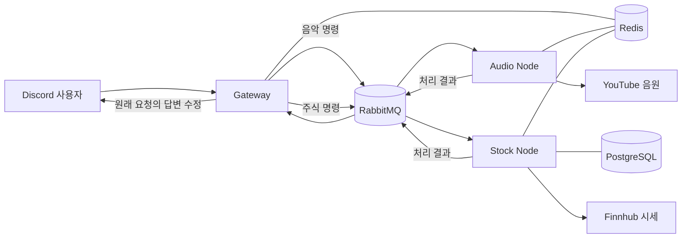
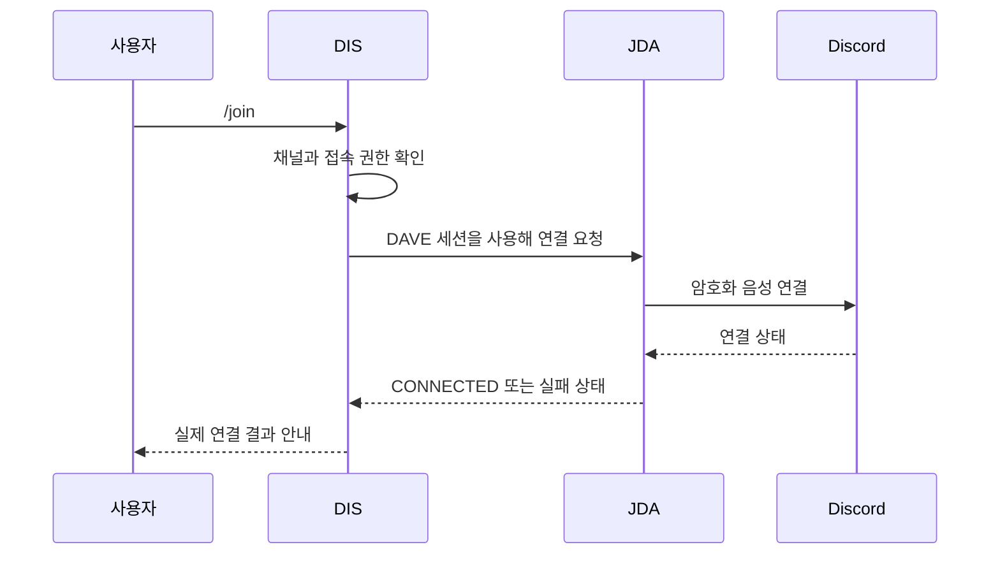

# DIS · Discord 음악·주식 모의투자 봇

DIS는 Discord 음성 채널에서 음악을 듣고, 채팅에서 가상 자금으로 주식을 거래할 수 있는 봇입니다. 직접 개발해 서버에 배포했고 현재 지인 약 30명과 사용하고 있습니다.

| 항목 | 내용 |
| --- | --- |
| 기간 | 2025.06~ |
| 형태 | 개인 프로젝트 |
| 담당 | 설계, 개발, 배포, 운영 |
| 주요 기술 | Java 21, Spring Boot, JDA, LavaPlayer, RabbitMQ, Redis, PostgreSQL, Docker Compose |
| 저장소 | [github.com/som141/dis](https://github.com/som141/dis) |

## 시작한 이유

2024년에 사용하던 Discord 음악 봇들이 제대로 동작하지 않는 일을 겪었습니다. 친구들과 음성 채널에서 음악을 듣는 용도였기 때문에 필요한 기능을 직접 만들어 보기로 했습니다.

처음에는 한 프로그램 안에서 명령 수신과 음악 재생을 모두 처리했습니다. 실제 서버에 올려 함께 사용하기 시작하자 로컬 실행만으로는 만나지 못했던 문제가 생겼습니다. Discord의 음성 보안 방식이 바뀌면서 연결이 되지 않았고, 기능이 늘수록 한 프로그램을 수정하고 다시 띄우는 부담도 커졌습니다. 이후에는 운영 중 생긴 문제를 고치면서 구조와 기능을 함께 바꿔 왔습니다.

## 사용 흐름

| 사용자가 하는 일 | 봇이 처리하는 일 |
| --- | --- |
| 음성 채널에서 `/play 백일` 실행 | 곡 검색, 음성 채널 연결, 재생과 대기열 관리 |
| `/pause`, `/skip`, `/stop` 실행 | 현재 길드의 플레이어와 대기열 제어 |
| `/stock quote AAPL` 실행 | Redis에 저장된 최근 시세 조회 |
| `/stock buy AAPL 1` 실행 | 잔고와 시세 확인 후 포지션·거래 내역 저장 |
| `/stock portfolio`, `/stock rank` 실행 | 보유 종목과 수익률, 기간별 순위 계산 |
| `/man` 실행 | 전체 사용법을 요청한 사람에게만 표시 |

음악 재생과 계좌 조회처럼 개인에게 필요한 안내는 본인에게만 보여 줍니다. 매수·매도와 수익률 순위처럼 함께 보는 기능은 채널에 공개합니다.

## 현재 구조

Gateway는 Discord 명령을 받고 답변할 위치를 기억합니다. Audio Node와 Stock Node는 RabbitMQ에서 각자 처리할 명령을 가져갑니다. 처리가 끝나면 결과를 다시 Gateway로 보내 원래 요청의 답변을 수정합니다.

Redis에는 음악 대기열과 재생 상태, 답변을 기다리는 요청, 최근 주식 시세를 저장합니다. PostgreSQL에는 모의투자 계좌와 보유 종목, 거래 내역을 저장합니다.

## Discord 음성 보안 변경에 대응한 과정

### 명령은 들어오지만 음성 채널 연결이 끝나지 않았습니다

봇이 `/join` 명령을 받고 연결을 시도했지만 음성 채널 입장이 완료되지 않는 문제가 생겼습니다. 텍스트 명령은 정상적으로 처리되고 있었기 때문에 봇 전체의 접속 문제가 아니라 음성 연결 과정부터 살펴봤습니다.

Discord 음성 연결에는 DAVE라는 종단 간 암호화 방식이 추가되어 있었습니다. 기존 오디오 전송 코드만으로는 새로운 연결 과정을 처리할 수 없어 JDA의 오디오 설정에 DAVE 세션 구현을 연결해야 했습니다.

### 개발 PC와 배포 서버의 실행 환경도 달랐습니다

JDA에 `LDJDADaveSessionFactory`를 연결하고 DAVE 구현을 추가한 뒤, 네이티브 라이브러리가 운영체제별로 다르다는 문제를 만났습니다. Windows 개발 환경에서 사용한 파일을 Linux 컨테이너에서 그대로 쓸 수 없었습니다. 로컬에서는 Windows x64, 배포 환경에서는 Linux x64용 네이티브 라이브러리를 사용하도록 의존성을 맞췄습니다.

연결 요청을 보냈다는 사실만으로 성공 처리하지 않고 JDA의 연결 상태를 확인하도록 바꿨습니다. 연결 성공, 재연결 불가, 권한 부족을 나누어 응답했고, 봇에 음성 채널 접속 권한이 있는지도 연결 전에 검사했습니다.

이 변경으로 Linux 서버에서도 음성 연결을 다시 사용할 수 있게 됐습니다. 이후 음성 관련 의존성을 바꿀 때는 Java 라이브러리 버전뿐 아니라 컨테이너에서 사용하는 네이티브 파일도 함께 확인하고 있습니다.

- [DAVE 세션을 JDA에 연결한 변경](https://github.com/som141/dis/commit/27387d73b9fb51c354ce98ad9b3eb47e35e60d9f)
- [Linux 배포 환경과 연결 상태 처리를 보완한 변경](https://github.com/som141/dis/commit/03392b91ab12c602da23df2cd9bc1ce80d825722)

## 한 프로그램을 세 역할로 나눈 과정

### 처음에는 명령과 재생 코드가 한곳에 있었습니다

초기 버전에서는 하나의 Listener가 Slash Command 처리, 음성 채널 연결, 곡 검색, 대기열 제어를 모두 맡았습니다. 기능 수가 적을 때는 빠르게 만들 수 있었지만 운영하면서 다음 문제가 보였습니다.

- Discord 응답 코드와 음악 재생 코드가 함께 바뀌어 수정 범위가 컸습니다.
- 재시작하면 메모리에 있던 길드별 대기열과 상태가 사라졌습니다.
- 음악 외 기능을 추가하면 한 프로그램 안에서 책임이 계속 섞이게 됐습니다.
- 한 기능의 문제를 고치기 위해 봇 전체를 다시 배포해야 했습니다.

서비스를 나누는 것부터 시작하지 않고 먼저 코드 안의 역할을 정리했습니다. 명령 처리, 음악 작업, 음성 연결, 상태 저장을 인터페이스로 나누고 인메모리 저장소를 Redis 저장소로 바꿀 수 있게 했습니다. 그다음 실행 앱을 Gateway와 Audio Node로 분리했습니다.

### 요청과 결과가 다시 만나는 방법이 필요했습니다

Discord 명령의 답변은 정해진 시간 안에 먼저 접수해야 합니다. Gateway가 작업을 Audio Node에 맡긴 뒤에는 어떤 결과가 어느 사용자의 요청인지 다시 찾을 수 있어야 했습니다.

각 명령에 `commandId`, 길드와 사용자 정보, 답변을 받을 Gateway 정보를 넣었습니다. Gateway는 Discord 답변 정보를 Redis에 저장한 뒤 RabbitMQ로 명령을 보냅니다. Audio Node는 작업 결과에 같은 `commandId`를 넣어 돌려주고, Gateway가 저장해 둔 원래 답변을 수정합니다.

오디오 노드가 같은 명령을 다시 받더라도 중복 실행하지 않도록 처리 기록을 남겼고, 재시작할 때 Redis에 저장된 재생 상태를 읽어 복구를 시도하도록 구성했습니다.

### 분리하면서 늘어난 일도 있습니다

앱을 나누자 RabbitMQ와 Redis 상태를 함께 살펴야 했고, 메시지 형식을 바꿀 때 양쪽 앱의 호환성도 고려해야 했습니다. Audio Node를 여러 개 띄우는 일도 단순하지 않습니다. 실제 플레이어를 가진 노드와 해당 길드의 다음 명령이 같은 곳으로 가야 하기 때문입니다.

현재 규모에서는 성능을 위해 나눈 구조라기보다 기능 경계와 장애 범위를 분명하게 만들기 위한 구조입니다. 음악과 주식 기능을 독립된 Node로 추가할 수 있게 된 것이 가장 큰 변화였습니다.

- [애플리케이션과 저장소 역할을 처음 분리한 변경](https://github.com/som141/dis/commit/af2a55f7df5f25c6d8dc750b268e2f9930b77e1e)
- [Gateway와 Audio Node의 메시지 흐름을 만든 변경](https://github.com/som141/dis/commit/c7dae08e92a14684512a9b09523a831b425c60f2)
- [현재 아키텍처](https://github.com/som141/dis/blob/main/docs/reference/CURRENT_ARCHITECTURE.md)

## 사용자 요청을 주식 모의투자 기능으로 만든 과정

음악을 함께 듣던 사용자들이 Discord 안에서 할 수 있는 다른 기능을 요청했습니다. 기존 음악 기능을 건드리지 않고 추가하기 위해 Stock Node를 별도 앱으로 만들었습니다. Gateway는 `/stock` 명령을 메시지로 바꾸는 일만 담당하고 계좌와 거래 규칙은 Stock Node 안에 두었습니다.

### 기능을 단계별로 연결했습니다

1. 음악 앱과 분리된 `stock-core`, `stock-node-app`을 만들고 명령과 결과 형식을 먼저 정했습니다.
2. PostgreSQL에 계좌, 포지션, 거래 원장, 스냅샷을 저장했습니다.
3. Redis에 시세를 저장하고 외부 API 호출 제한을 관리했습니다.
4. 시세 조회와 매수·매도, 잔고, 포트폴리오, 거래 내역을 구현했습니다.
5. Gateway에 `/stock` 명령을 추가해 기존 RabbitMQ 요청·응답 흐름에 연결했습니다.
6. 일간·주간·월간 수익률 순위와 월별 시즌, 레버리지와 자동 청산을 추가했습니다.

### 명령마다 외부 시세 API를 호출하지 않았습니다

사용자가 시세를 조회하거나 거래할 때마다 Finnhub를 호출하면 사용량 제한에 빠르게 도달하고 응답 시간도 외부 서비스에 좌우됩니다. 활성 종목의 시세를 주기적으로 갱신해 Redis에 보관하고, Discord 명령은 캐시를 읽도록 구성했습니다.

거래에는 조회보다 짧은 시세 유효 시간을 적용합니다. 시세가 오래됐거나 준비되지 않은 경우에는 이전 가격으로 거래를 진행하지 않고 사용자에게 다시 시도하도록 알립니다. 계좌 잔고 변경, 포지션 변경, 거래 원장 기록은 하나의 트랜잭션에서 처리합니다.

### Discord 안에서 게임처럼 사용할 수 있게 했습니다

사용자는 별도 회원가입 없이 Discord의 길드와 사용자 ID로 시즌 계좌를 구분합니다. 가상 자금으로 정수 수량의 주식을 사고팔 수 있고, 포트폴리오와 거래 내역을 본인만 확인할 수 있습니다. 순위는 채널에 공개해 함께 비교할 수 있게 했습니다.

새 기능을 기존 음악 앱에 넣지 않고 Stock Node로 추가하면서, 앞서 나눈 Gateway와 메시징 구조가 실제 기능 확장에 사용됐습니다.

- [Stock Node의 시작](https://github.com/som141/dis/commit/d4b92afbb19020bc2b345d1517df187469a30585)
- [Discord 명령과 Stock Node를 연결한 변경](https://github.com/som141/dis/commit/f110cc4e7e1bf3a92a0d087661862ac5bb05b2c2)
- [순위와 스냅샷을 추가한 변경](https://github.com/som141/dis/commit/3bd4d3032b51c55643248ba9ba2c3be71c2bbcb7)

## 운영하면서 추가한 것

배포는 `main` 브랜치 변경을 기준으로 GitHub Actions에서 테스트와 이미지 빌드를 거쳐 Linux 서버에 반영됩니다. Gateway, Audio Node, Stock Node를 각각 이미지로 만들고 Docker Compose로 실행합니다.

앱의 상태와 명령 처리량은 Prometheus에서 수집하고 Grafana에서 확인합니다. Docker 로그는 Alloy가 Loki로 전달합니다. 주식 시세 갱신 실패, 오래된 캐시, 거래 실패와 같은 상태는 Stock Node 메트릭으로 따로 확인할 수 있게 했습니다.

2026년 10월에는 `/play`가 접수된 뒤 실제 음원을 받지 못해 소리가 나지 않는 문제도 겪었습니다. YouTube 인증과 음원 요청 과정을 로그로 나눠 확인해 재생을 복구했고, 뒤늦게 발생한 재생 실패도 처음 보낸 Discord 응답에 표시하도록 바꿨습니다. 이 일을 겪은 뒤에는 컨테이너 상태뿐 아니라 실제 음성 채널에서 소리가 나는 것까지 배포 확인 항목에 넣었습니다.

## 현재 남아 있는 점

- Audio Node를 여러 대로 늘리려면 길드별 플레이어를 어느 노드가 맡는지 정하는 과정이 더 필요합니다.
- YouTube와 주식 시세 공급자가 응답 방식을 바꾸면 봇도 영향을 받으므로 외부 연동 상태를 계속 살펴야 합니다.
- 현재 사용 인원은 약 30명이지만, 장기간 요청량과 동시 이용자 수를 꾸준히 기록한 자료는 아직 부족합니다.
- 배포 시 새 컨테이너로 교체하는 동안 짧은 중단이 발생할 수 있습니다.

[프로젝트 목록으로 돌아가기](README.md) · [이력서로 돌아가기](../README.md)
