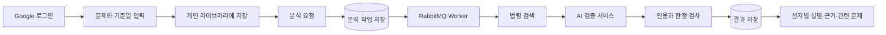

# LawGround · 법령 근거 기반 기출문제 분석

LawGround는 공인중개사 문제의 정답 근거를 법령에서 찾아 보여주고, 같은 근거를 다루는 문제를 추천하는 팀 프로젝트입니다. 저는 Spring 백엔드와 데이터베이스를 만들고 팀원의 AI 서비스가 분석 결과를 주고받을 수 있도록 연결했습니다.

| 항목 | 내용 |
| --- | --- |
| 기간 | 2026.10~ |
| 형태 | 팀 프로젝트 |
| 담당 | Spring 백엔드, DB, 사용자 화면 연결, AI 서비스 연동 |
| 주요 기술 | Java 21, Spring Boot, PostgreSQL/pgvector, RabbitMQ, Docker |
| 저장소 | [github.com/lawground-team/LawGround](https://github.com/lawground-team/LawGround) |

## 만들고 있는 서비스

기출문제 해설에는 정답만 적혀 있거나 출처가 오래된 경우가 있습니다. LawGround는 문제 본문과 다섯 개 선지, 제공 정답, 문제의 기준일을 입력받아 당시 적용되는 법령을 찾습니다. 분석 결과에는 선지별 설명과 인용한 조문을 함께 보여주고, 같은 법령을 근거로 하는 관련 문제를 추천합니다.

## 로그인부터 개인 문제 보관함까지

사용자가 먼저 만나는 기능은 Google 로그인과 개인 문제 보관함입니다. Google OIDC로 받은 식별자를 회원과 연결하고, 로그인 상태는 JDBC Session에 저장했습니다. 문제 등록과 수정처럼 상태를 바꾸는 요청에는 CSRF 검사를 적용했습니다.

문제는 본문만 저장하지 않고 다섯 개 선지, 제공 정답, 기준일, 공개 범위를 함께 저장합니다. 모든 조회와 수정에서 소유자를 확인해 다른 사용자의 비공개 문제에 접근할 수 없게 했습니다. 같은 문제를 중복 등록하는 경우와 동시에 수정된 문제를 오래된 화면에서 다시 저장하는 경우도 구분했습니다.

문제마다 revision을 두고 수정 요청이 현재 revision과 맞는지 확인합니다. 다른 탭이나 요청에서 먼저 수정됐다면 덮어쓰지 않고 다시 불러오도록 응답합니다. 사용자는 라이브러리에서 자신의 문제를 검색하고 상세 내용을 확인하거나 수정·삭제할 수 있습니다.

- [문제 관리와 개인 라이브러리를 만든 PR](https://github.com/lawground-team/LawGround/pull/10)
- [Google 로그인과 실제 DB 화면을 연결한 PR](https://github.com/lawground-team/LawGround/pull/14)

## 오래 걸리는 분석을 작업으로 처리한 이유

법령 검색과 AI 분석은 일반적인 DB 조회보다 오래 걸립니다. HTTP 요청 하나를 계속 열어둔 채 모든 작업을 끝내면 사용자가 화면을 닫거나 연결이 끊겼을 때 진행 상태를 찾기 어렵습니다. 분석 요청을 별도의 작업으로 저장하고 RabbitMQ Worker가 처리하도록 구성했습니다.

사용자가 분석을 요청하면 먼저 실행 ID와 입력 당시의 문제를 저장합니다. 화면은 실행 ID로 현재 단계를 조회합니다. 새로고침하거나 잠시 다른 화면으로 이동해도 서버 작업은 계속되고, 돌아왔을 때 실제 저장된 상태를 볼 수 있습니다.

같은 요청이 네트워크 문제로 다시 전송되더라도 분석 작업을 중복으로 만들지 않도록 멱등 키를 사용합니다. Worker는 검색과 검증 단계마다 진행 위치를 저장합니다. 처리 중 멈춘 작업은 임대 시간이 지난 뒤 다시 가져올 수 있고, 이전 Worker가 늦게 결과를 저장하지 못하도록 실행 번호를 비교합니다.

실패를 무조건 처음부터 다시 돌리지 않고 마지막으로 끝낸 단계부터 이어갈 수 있게 한 이유는 외부 AI 호출과 검색을 불필요하게 반복하지 않기 위해서입니다.

- [검색 파이프라인을 큐 작업으로 연결한 PR](https://github.com/lawground-team/LawGround/pull/19)

## 법령 검색과 AI 결과를 연결한 방법

법령은 문제의 기준일에 시행 중인 버전만 검색 대상으로 사용합니다. PostgreSQL의 단어 검색 결과와 pgvector의 의미 검색 결과를 각각 구한 뒤, 두 결과의 순위를 합쳐 후보를 만듭니다. AI 서비스에는 전체 법령을 보내지 않고 이 후보와 문제를 전달합니다.

팀원의 Python 서비스는 후보의 순서를 다시 정하고 선지와 근거의 관계를 반환합니다. 제가 맡은 Spring 쪽에서는 요청과 응답 형식을 고정하고 다음 항목을 다시 검사했습니다.

- 응답이 요청한 문제와 같은 실행에 대한 것인지
- 인용한 법령과 버전이 실제 DB에 있는지
- 인용 범위가 저장된 원문 안에 들어오는지
- 문제 기준일에 사용할 수 있는 법령인지
- 다섯 개 선지와 근거 연결이 중복되거나 빠지지 않았는지

검사를 통과한 판정, 선지별 설명, 인용 근거는 한 트랜잭션에서 저장합니다. 분석 중 사용자가 문제를 수정하더라도 결과에는 실행을 시작할 때 저장한 문제 내용을 보여줘 현재 문제와 섞이지 않게 했습니다.

- [Spring과 AI HTTP·법령 검색을 연결한 PR](https://github.com/lawground-team/LawGround/pull/17)
- [판정과 인용 근거를 검사하고 저장한 PR](https://github.com/lawground-team/LawGround/pull/21)
- [선지별 설명과 근거 연결을 추가한 PR](https://github.com/lawground-team/LawGround/pull/27)

## 관련 문제 추천

분석이 끝난 문제에는 같은 조문을 근거로 하는 문제를 우선 추천합니다. 직접 연결되는 조문이 부족하면 문제 임베딩의 유사도를 사용합니다. 추천할 때도 사용자가 볼 수 있는 공개 문제와 자신의 문제만 후보로 사용합니다.

현재 문제의 revision과 임베딩을 만든 모델 버전이 맞지 않으면 오래된 색인을 사용하지 않습니다. 추천 API는 요청할 때 AI 서비스를 다시 호출하지 않고 DB에 준비된 후보를 조회하므로 분석 결과 화면을 열 때마다 외부 호출이 늘어나지 않습니다.

- [근거 조문과 문제 임베딩으로 추천하는 PR](https://github.com/lawground-team/LawGround/pull/25)

## 팀에서 맡은 범위

제가 구현한 범위는 Spring 애플리케이션, PostgreSQL 스키마, 사용자 화면과 API 연결, RabbitMQ 작업 처리, Python AI 서비스의 HTTP 연동입니다. Python 모델과 프롬프트 구현은 다른 팀원이 담당했습니다.

프로젝트의 초기 계약과 오류 응답 형식을 정한 뒤 기능을 한꺼번에 붙이지 않고 문제 관리, 로그인, 검색, Worker, 결과 저장 순서로 연결했습니다. 각 단계가 실제 DB와 큐를 사용하는 통합 테스트에서 이어지는지 확인했고, 브라우저에서도 로그인부터 결과 조회까지 같은 흐름을 실행하도록 구성했습니다.

## 현재 상태와 남은 일

Google 로그인, 사용자별 문제 등록·조회·수정·삭제, 분석 작업 저장과 재개, 법령 검색, AI API 연결, 결과와 추천 저장 경로가 구현되어 있습니다.

실제 서비스 품질을 말하려면 공식 법령과 기출문제 수집 범위, 사람이 검수한 정답 자료, 실제 모델을 사용한 정확도 비교가 더 필요합니다. 현재 합성 데이터로 통합 흐름을 확인한 결과를 실제 법률 판정 정확도로 사용하지 않고 있습니다. 배포 환경과 운영 모니터링도 남아 있습니다.

[프로젝트 목록으로 돌아가기](README.md) · [이력서로 돌아가기](../README.md)
