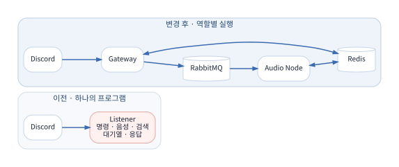
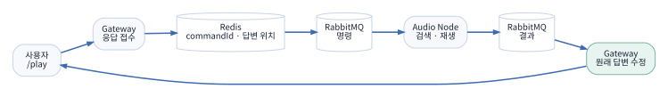
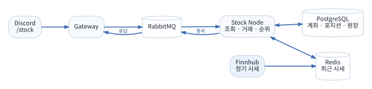
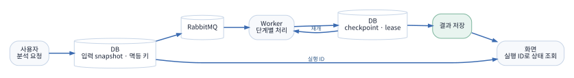

::: {.page .cover}

{.cover-photo}

# 윤영주

## Backend Portfolio

Java · Spring Backend Developer

::: {.cover-projects}

**DIS**  Discord 음악·주식 모의투자 봇<br>
**LawGround**  법령 근거 기반 기출문제 분석<br>
**Verbly**  영어 일기 첨삭·복습 서비스

:::

::: {.cover-contact}

GitHub  github.com/som141<br>
Contact  010-8977-9897<br>
Major  단국대학교 소프트웨어학과

:::

<div class="page-no">01</div>

:::

::: {.page}

<div class="eyebrow">CONTENTS</div>

# 목차

::: {.toc-grid}

::: {.toc-list}

**DIS · Discord 음악·주식 모의투자 봇**

03　만든 이유와 현재 기능<br>
04　Discord 음성 보안 변경 대응<br>
05　모놀리식 봇을 분리한 과정<br>
06　명령과 결과, 재생 상태의 이동<br>
07　주식 모의투자 기능 확장<br>
08　배포와 운영

**LawGround · 법령 근거 기반 기출문제 분석**

09　사용자 문제 저장과 개인 라이브러리<br>
10　오래 걸리는 분석 작업의 저장과 재개<br>
11　법령 검색과 AI 분석 결과 연결

**Verbly · 영어 일기 첨삭·복습 서비스**

12　개인 라이브러리와 첨삭 연계<br>
13　복습 퀴즈

:::

::: {.project-summary}

| 프로젝트 | 기간 | 담당 |
| --- | --- | --- |
| DIS | 2025.06~ | 설계·개발·배포·운영 |
| LawGround | 2026.10~ | Spring 백엔드·DB·서비스 연결 |
| Verbly | 2026.01–02 | 라이브러리·복습 퀴즈 백엔드 |

**주로 사용한 기술**

Java · Spring Boot · Spring Data JPA<br>
PostgreSQL · MySQL · Redis · RabbitMQ<br>
Docker Compose · GitHub Actions<br>
Prometheus · Grafana · Loki · Alloy

:::

:::

<div class="page-no">02</div>

:::

::: {.page}

<div class="eyebrow">DIS · 2025.06~ · 개인 프로젝트</div>

# 사용하던 음악 봇이 멈춘 뒤 직접 만들기 시작했습니다

2024년, 친구들과 Discord 음성 채널에서 사용하던 음악 봇들이 제대로 동작하지 않는 일을 겪었습니다. 필요한 기능을 직접 만들어 보기로 했고 2025년 6월부터 DIS를 개발했습니다. 현재는 지인 약 30명과 음악 재생과 주식 모의투자 기능을 사용하고 있습니다.

{.diagram .wide}

::: {.two-col}

::: {.panel}

## 음악

- `/play`로 검색하거나 URL로 곡 재생
- 일시정지, 다시 재생, 건너뛰기, 정지
- 길드별 대기열과 자동 재생
- 음성 채널이 비면 자동 퇴장
- `/man`으로 전체 사용법을 본인에게만 표시

:::

::: {.panel}

## 주식 모의투자

- 실시간 시세 조회와 관심 종목 목록
- 가상 자금으로 정수 수량 매수·매도
- 잔고, 포트폴리오, 거래 내역 조회
- 일간·주간·월간 수익률 순위
- 월별 시즌, 레버리지와 자동 청산

:::

:::

처음에는 명령과 음악 재생이 한 프로그램 안에 있었습니다. 실제 서버에서 운영하면서 Discord 음성 보안 변경, 메모리 상태 유실, 외부 음원 요청 실패를 겪었습니다. 문제를 고치는 과정에서 Gateway와 Audio Node를 나눴고, 그 구조 위에 Stock Node를 추가했습니다.

::: {.fact-row}

**사용 인원** 약 30명　　**실행 환경** Linux · Docker Compose　　**저장소** github.com/som141/dis

:::

<div class="page-no">03</div>

:::

::: {.page}

<div class="eyebrow">DIS · VOICE SECURITY</div>

# 명령은 들어왔지만 음성 채널 연결이 끝나지 않았습니다

봇은 `/join` 명령을 받고 연결을 시도했지만 음성 채널 입장이 완료되지 않았습니다. 텍스트 명령은 정상적으로 처리되고 있었기 때문에 Discord 접속 전체가 아니라 음성 연결 단계부터 확인했습니다.

Discord 음성 연결에는 DAVE 종단 간 암호화 방식이 추가되어 있었습니다. 기존 오디오 전송 코드만으로는 새 연결 과정을 처리할 수 없어 JDA의 오디오 설정에 DAVE 세션 구현을 연결했습니다.

{.diagram .wide}

::: {.two-col}

::: {.panel}

## 실행 환경까지 함께 맞췄습니다

DAVE 구현은 네이티브 라이브러리를 사용합니다. Windows 개발 PC에서 사용하는 파일을 Linux 서버에서 그대로 쓸 수 없었기 때문에 로컬과 컨테이너에 맞는 파일을 각각 지정했습니다.

```java
var daveFactory = new NativeDaveFactory();
var daveSessionFactory =
    new LDJDADaveSessionFactory(daveFactory);

var audioConfig = new AudioModuleConfig()
    .withDaveSessionFactory(daveSessionFactory);
```

:::

::: {.panel}

## 요청과 실제 연결을 구분했습니다

`openAudioConnection`을 호출했다는 이유만으로 성공 메시지를 보내지 않았습니다. JDA가 돌려주는 연결 상태를 확인해 `CONNECTED`일 때 입장 완료를 알렸습니다.

- 연결 전 `VOICE_CONNECT` 권한 확인
- 이미 같은 채널에 들어와 있는지 확인
- 연결 유실과 재개 불가 상태를 따로 안내
- Linux 컨테이너용 DAVE 네이티브 적용

:::

:::

이후 음성 기능을 바꿀 때는 Java 라이브러리 버전과 서버 운영체제용 네이티브 파일을 함께 확인하고 있습니다. 연결 요청 로그와 실제 연결 완료 로그도 구분해 남겼습니다.

<div class="page-no">04</div>

:::

::: {.page}

<div class="eyebrow">DIS · ARCHITECTURE</div>

# 기능이 늘면서 하나의 프로그램을 계속 수정하기 어려워졌습니다

초기 버전에서는 하나의 Listener가 Slash Command 처리, 음성 채널 연결, 곡 검색, 대기열 제어와 사용자 응답을 모두 담당했습니다. 기능 수가 적을 때는 빠르게 만들 수 있었지만, 음악 코드를 고칠 때 Discord 응답까지 영향을 받았고 재시작하면 메모리에 있던 대기열과 재생 상태가 사라졌습니다.

{.diagram .wide}

## 실행 앱을 나누기 전에 코드의 역할부터 나눴습니다

1. 명령 처리와 음악 작업을 Application Service로 분리했습니다.
2. 음성 연결과 재생 기능을 인터페이스 뒤로 옮겼습니다.
3. 메모리에 있던 길드 상태와 대기열을 Redis 저장소로 교체할 수 있게 했습니다.
4. Discord 명령을 받는 Gateway와 음악을 실행하는 Audio Node를 별도 앱으로 만들었습니다.
5. RabbitMQ로 명령과 결과를 주고받고 앱별 Docker 이미지를 만들었습니다.

::: {.two-col}

::: {.panel}

**Gateway**

Discord 연결, 명령 등록, 입력 확인, 답변 위치 저장과 결과 회신을 담당합니다.

:::

::: {.panel}

**Audio Node**

음악 명령을 소비하고 곡 검색, 대기열, 음성 연결과 재생 상태를 담당합니다.

:::

:::

이 구조는 현재 규모에서 처리량을 높이기 위해 만든 것이 아닙니다. 음악과 Discord 응답의 변경 범위를 나누고, 이후 주식 기능을 기존 음악 코드 밖에 추가할 수 있게 만드는 것이 목적이었습니다.

<div class="page-no">05</div>

:::

::: {.page}

<div class="eyebrow">DIS · COMMAND FLOW</div>

# 떨어진 앱 사이에서 원래 Discord 요청을 다시 찾아야 했습니다

Discord의 Slash Command는 정해진 시간 안에 먼저 응답을 접수해야 합니다. Gateway가 작업을 Audio Node에 맡긴 뒤에는 어떤 결과가 어느 사용자의 명령에서 시작됐는지, 어떤 Discord 답변을 수정해야 하는지 다시 찾을 수 있어야 했습니다.

{.diagram .wide}

::: {.two-col}

::: {.panel}

## 명령에 함께 보내는 정보

| 값 | 용도 |
| --- | --- |
| commandId | 요청과 결과 연결 |
| guildId | 서버별 플레이어 구분 |
| userId | 요청자와 계좌 구분 |
| textChannelId | 응답 채널 확인 |
| responseTargetNode | 결과를 받을 Gateway 지정 |

Gateway는 답변 위치를 Redis에 먼저 저장한 뒤 명령을 발행합니다. 결과가 매우 빨리 와도 답변 정보를 찾을 수 있도록 순서를 고정했습니다.

:::

::: {.panel}

## 재시작과 중복 처리

- 처리한 `commandId`를 남겨 같은 음악 명령의 재실행 방지
- 길드별 대기열과 플레이어 상태를 Redis에 저장
- Audio Node 시작 시 저장된 상태로 복구 시도
- 성공한 `/play`도 이후 다운로드 실패를 받을 수 있도록 답변 정보 유지

Redis의 답변 정보에는 유효 시간이 있어 오래 대기한 곡의 실패는 로그로 확인해야 할 수 있습니다. Audio Node를 여러 대로 늘리려면 길드의 실제 플레이어를 가진 노드로 다음 명령을 보내는 규칙도 더 필요합니다.

:::

:::

앱을 나눈 뒤 RabbitMQ와 Redis를 함께 운영해야 하고 메시지 형식을 바꿀 때 양쪽 호환성을 고려해야 하는 일이 늘었습니다. 대신 Discord 연결, 음악 재생, 이후 추가된 주식 기능의 경계가 코드와 실행 환경에서 분명해졌습니다.

<div class="page-no">06</div>

:::

::: {.page}

<div class="eyebrow">DIS · STOCK GAME</div>

# 함께 쓰는 사용자들의 요청으로 주식 게임을 추가했습니다

음악을 함께 듣던 사용자들이 Discord 안에서 즐길 수 있는 기능을 요청했습니다. 기존 음악 처리와 섞지 않기 위해 Stock Node를 별도 앱으로 만들고, Gateway에는 `/stock` 명령을 메시지로 바꾸고 결과를 돌려주는 역할만 추가했습니다.

{.diagram .wide}

::: {.two-col}

::: {.panel}

## 기능을 붙인 순서

1. Stock Node와 공용 명령 형식 작성
2. 계좌·포지션·거래 원장 DB 구성
3. Redis 시세 캐시와 외부 API 사용량 관리
4. 매수·매도와 잔고·포트폴리오 구현
5. Gateway의 `/stock` 명령과 연결
6. 수익률 순위, 월 시즌, 레버리지와 청산 추가

계좌는 Discord 길드, 사용자, 월 시즌을 기준으로 구분합니다. 별도 회원가입 없이 Discord 사용자를 모의투자 계좌와 연결합니다.

:::

::: {.panel}

## 명령마다 Finnhub를 호출하지 않았습니다

활성 종목의 시세를 주기적으로 받아 Redis에 보관하고 Discord 명령은 캐시를 읽습니다. 외부 API 사용량과 응답 시간을 줄이고 여러 사용자가 같은 시세를 공유할 수 있습니다.

- 거래에는 조회보다 짧은 시세 유효 시간 적용
- 시세가 오래됐거나 없으면 거래 거절
- 잔고·포지션·거래 원장을 한 트랜잭션에서 변경
- 계좌·포트폴리오·내역은 요청자에게만 표시
- 매수·매도와 수익률 순위는 채널에 공개

:::

:::

주식 기능은 음악 앱의 내부 코드를 호출하지 않습니다. 같은 Gateway와 RabbitMQ 응답 방식을 사용하지만 계좌와 거래 규칙, DB는 Stock Node가 소유합니다. 앞서 나눈 실행 구조가 실제 기능 확장에 사용된 사례입니다.

<div class="page-no">07</div>

:::

::: {.page}

<div class="eyebrow">DIS · OPERATION</div>

# 서버에서 계속 사용할 수 있도록 배포와 로그까지 관리했습니다

`main` 브랜치에 변경이 들어오면 GitHub Actions가 테스트와 JAR 패키징, 앱별 이미지 빌드를 진행합니다. 이미지는 Linux 서버로 전달되고 Docker Compose가 Gateway, Audio Node, Stock Node와 Redis, RabbitMQ, PostgreSQL을 함께 실행합니다.

{.diagram .wide}

## 재생 안내는 나왔지만 실제로 소리가 나지 않았습니다

2026년 10월 `/play` 명령이 곡을 찾고 재생 안내까지 보냈지만 음성 데이터가 나오지 않는 일이 있었습니다. 음악 로그를 따라 검색, 인증 갱신, 음원 다운로드를 나누어 확인했습니다. YouTube 인증은 정상적으로 갱신됐지만 실제 음원 주소를 받는 방식에서 여러 클라이언트가 실패하고 있었습니다.

음원 요청 방식과 cipher 서비스를 수정해 재생을 복구했습니다. 함께 바꾼 부분은 사용자 응답이었습니다. 곡을 찾았다는 이유로 재생 성공을 알리지 않고 먼저 요청 접수를 표시하며, 이후 다운로드나 재생에서 실패하면 처음 보낸 Discord 답변을 실패 상태로 바꾸도록 했습니다.

::: {.two-col}

::: {.panel}

## 운영 중 확인하는 항목

- 각 앱의 health와 RabbitMQ·Redis·DB 연결
- 음악 명령 실패와 재생 실패 로그
- 주식 시세 갱신 성공·실패와 캐시 나이
- 거래 성공·거절·실패 건수
- 실제 Discord 명령과 음성 출력

:::

::: {.panel}

## 남아 있는 점

- 장기간 요청량과 동시 이용자 기록 부족
- Audio Node 확장 시 길드별 플레이어 배정 필요
- YouTube·시세 공급자 변경에 계속 영향받음
- 컨테이너 교체 중 짧은 중단 가능

:::

:::

<div class="page-no">08</div>

:::

::: {.page}

<div class="eyebrow">LAWGROUND · 2026.10~ · 팀 프로젝트</div>

# 문제를 저장하고 기준일에 맞는 법령 근거를 찾습니다

LawGround는 공인중개사 문제의 정답 근거를 법령에서 찾아 보여주고, 같은 근거를 다루는 문제를 추천하는 서비스입니다. 저는 Spring 백엔드와 PostgreSQL, 사용자 화면 연결, 팀원의 Python AI 서비스와 통신하는 부분을 맡았습니다.

{.diagram .wide}

::: {.two-col}

::: {.panel}

## 문제에 저장하는 정보

- 문제 본문과 다섯 개 선지
- 시험지나 교재에서 제공한 정답
- 법령을 판단할 기준일
- 소유자와 공개 범위
- 수정 충돌을 확인할 revision

문제의 기준일은 필수로 받습니다. 과거 문제에 현재 법령을 자동으로 적용하지 않고 해당 날짜에 시행 중인 법령을 찾기 위해서입니다.

:::

::: {.panel}

## 개인 문제 라이브러리

Google OIDC 식별자를 회원과 연결하고 로그인 상태는 JDBC Session에 저장합니다. 등록과 수정 요청에는 CSRF 검사를 적용했습니다.

조회·수정·삭제마다 소유자를 확인해 다른 사용자의 비공개 문제에 접근하지 못하게 했습니다. 같은 문제의 중복 등록과 오래된 화면에서 현재 내용을 덮어쓰는 수정도 구분합니다.

:::

:::

사용자는 자신의 문제를 등록하고 라이브러리에서 검색하거나 수정할 수 있습니다. 분석을 시작하면 입력 당시 문제를 별도로 보관하므로, 처리 중 원본 문제를 수정해도 결과 화면에는 분석을 시작했을 때의 내용이 표시됩니다.

::: {.fact-row}

**담당** Spring 백엔드 · DB · 사용자 화면 연결 · AI HTTP 연동　　**저장소** github.com/lawground-team/LawGround

:::

<div class="page-no">09</div>

:::

::: {.page}

<div class="eyebrow">LAWGROUND · JOB PROCESSING</div>

# 검색과 분석이 끝날 때까지 화면을 계속 열어둘 수 없었습니다

법령 검색과 AI 분석은 일반적인 DB 조회보다 오래 걸립니다. 하나의 HTTP 요청을 열어 둔 채 모든 작업을 끝내면 사용자가 화면을 닫거나 네트워크가 끊겼을 때 진행 상태를 다시 찾기 어렵습니다. 분석 요청을 DB 작업으로 저장하고 RabbitMQ Worker가 이어서 처리하도록 구성했습니다.

{.diagram .wide}

::: {.two-col}

::: {.panel}

## 요청이 다시 들어와도 작업은 하나만 만듭니다

사용자가 분석을 요청하면 입력 당시 문제, 기준일, 실행 설정과 멱등 키를 저장합니다. 같은 요청이 네트워크 문제로 다시 전송되면 기존 실행 ID를 반환합니다.

화면은 실행 ID로 실제 처리 단계를 조회합니다. 새로고침하거나 다른 화면으로 이동해도 Worker의 작업은 계속됩니다.

:::

::: {.panel}

## 멈춘 작업을 이어서 처리합니다

Worker는 검색, 리랭크, 검증과 저장 단계가 끝날 때마다 진행 위치를 남깁니다. 처리 중 중단된 작업은 임대 시간이 지난 뒤 다른 Worker가 가져갈 수 있습니다.

이전 Worker가 늦게 돌아와 새 결과를 덮어쓰지 않도록 실행 번호를 비교합니다. 이미 끝낸 외부 AI 호출과 검색을 처음부터 반복하지 않고 마지막 완료 단계부터 이어갑니다.

:::

:::

| 화면 상태 | 서버에서 처리하는 상태 |
| --- | --- |
| 분석 대기 | 작업이 저장되고 Worker를 기다리는 중 |
| 처리 중 | 검색·리랭크·검증 단계 진행 중 |
| 근거 확인 / 불일치 / 판단 보류 | 정상적으로 끝난 법령 판정 |
| 분석 실패 | 외부 호출, 계약, 저장 중 기술 실패 |
| 취소 | 사용자가 취소해 더 이상 진행하지 않음 |

<div class="page-no">10</div>

:::

::: {.page}

<div class="eyebrow">LAWGROUND · SEARCH & AI</div>

# AI가 돌려준 문장을 그대로 저장하지 않았습니다

법령은 문제의 기준일에 시행 중인 버전만 검색합니다. PostgreSQL 단어 검색과 pgvector 의미 검색으로 후보를 각각 구한 뒤 순위를 합칩니다. AI 서비스에는 전체 법령이 아니라 문제와 상위 후보를 전달합니다.

{.diagram .wide}

::: {.two-col}

::: {.panel}

## Spring에서 다시 확인한 항목

- 응답이 같은 분석 실행에 대한 것인지
- 인용한 법령과 버전이 DB에 존재하는지
- 인용 범위가 실제 원문 안에 들어오는지
- 문제 기준일에 사용할 수 있는 조문인지
- 다섯 선지의 결과가 빠지거나 중복되지 않았는지

검사를 통과한 판정, 선지별 설명과 인용 근거는 한 트랜잭션에서 저장합니다. 관련 문제는 같은 조문을 우선하고 부족하면 문제 임베딩 유사도를 사용합니다.

:::

::: {.panel}

## 팀에서 맡은 범위

**직접 구현**

Spring 애플리케이션, PostgreSQL 스키마, RabbitMQ Worker, 사용자 화면과 API 연결, Python 서비스 HTTP 연동, 응답 검사와 결과 저장

**팀원 담당**

Python 모델, 프롬프트와 실제 추론 로직

공식 법령·기출 자료의 수집 범위와 사람이 검수한 정답 자료, 실제 모델 정확도 비교는 더 필요합니다. 합성 데이터로 확인한 통합 흐름을 법률 판정 정확도로 사용하지 않고 있습니다.

:::

:::

이 프로젝트에서는 AI 호출 자체보다 입력 당시의 사실을 보존하고, 검색한 법령과 반환된 인용이 실제 데이터와 맞는지 확인한 뒤 사용자에게 보여주는 부분을 맡았습니다.

<div class="page-no">11</div>

:::

::: {.page}

<div class="eyebrow">VERBLY · 2026.01–02 · 팀 프로젝트</div>

# 첨삭에서 배운 표현을 다시 찾을 수 있게 만들었습니다

Verbly는 사용자가 쓴 영어 일기를 AI와 원어민에게 첨삭받고, 고친 표현을 개인 라이브러리와 퀴즈로 복습하는 서비스입니다. 저는 개인 라이브러리와 복습 퀴즈 백엔드를 담당했습니다.

{.diagram .wide}

::: {.two-col}

::: {.panel}

## 개인 라이브러리

표현, 한국어·영어 뜻, 예문, 북마크와 삭제 상태를 저장합니다. 같은 표현이 대소문자나 불필요한 공백 때문에 여러 번 생기지 않도록 정리한 값을 함께 관리했습니다.

조회에는 검색어, 북마크와 페이지 조건을 적용합니다. 수정·삭제·예문 변경 때는 요청한 사용자 소유의 항목인지 먼저 확인합니다. 삭제는 상태값으로 처리해 기존 첨삭 출처와 연결을 보존했습니다.

:::

::: {.panel}

## 첨삭 결과와 연결

사용자가 첨삭 내용을 다시 입력하지 않도록 원래 표현, 고친 표현, 뜻과 여러 예문을 한 번에 받았습니다. 이미 저장된 표현이면 새 항목을 만들지 않고 출처와 예문을 추가합니다.

출처에는 게시글, 첨삭, 피드백, 문장 위치를 기록합니다. 어떤 글에서 배운 표현인지 다시 찾을 수 있고, 같은 표현을 여러 글에서 만난 기록도 남길 수 있습니다.

:::

:::

처음에는 등록·조회·수정·삭제가 한 서비스에 모여 있었습니다. 기능이 늘면서 조회와 변경 서비스를 나누고 DTO 변환과 소유권 검사를 별도 클래스로 옮겼습니다. 팀의 일기·첨삭 데이터 형식이 바뀔 때는 연결 DTO와 반환값을 맞췄습니다.

::: {.fact-row}

**담당** 개인 라이브러리 · 첨삭 데이터 연결 · 복습 퀴즈　　**저장소** github.com/Verbly-Official/BE

:::

<div class="page-no">12</div>

:::

::: {.page}

<div class="eyebrow">VERBLY · REVIEW QUIZ</div>

# 학습할 표현과 한 번의 퀴즈 진행을 따로 관리했습니다

라이브러리에 저장된 표현을 문제로 만들고 답안과 진행 상태를 보관하기 위해 세션, 학습 항목, 문제와 답안을 나누었습니다.

{.diagram .wide}

::: {.two-col}

::: {.panel}

## 퀴즈 진행

1. 대기 중인 라이브러리 항목을 세션에 배정
2. 예문에서 표현을 가린 빈칸 문제와 객관식 문제 생성
3. 현재 순서와 사용자 소유권 확인 후 답안 저장
4. 정답과 설명, 다음 문제 반환
5. 마지막 문제 뒤 세션과 학습 항목 완료 처리

힌트는 세션 전체 사용 횟수로 관리합니다. 다른 문제의 답을 먼저 제출하거나 다른 사용자의 세션에 접근하면 요청을 거절합니다.

:::

::: {.panel}

## 종료와 오답 재도전

중간에 나가면 세션이 잡고 있던 항목을 다시 대기 상태로 돌립니다. 끝난 세션에서는 각 문제의 마지막 답안을 기준으로 틀린 항목만 골라 새 문제를 만듭니다.

기존 문제를 다시 만들 때 참조 관계를 고려해 답안을 먼저 지우고 문제를 삭제했습니다. 이후 학습 항목을 새 세션에 배정합니다.

:::

:::

## 다시 개발한다면

퀴즈 출제 서비스에 문제 생성, 채점과 재도전 규칙이 많이 모여 있습니다. 문제 유형별 생성 규칙을 분리하고 시간과 무작위 선택을 테스트에서 고정할 수 있게 바꾸고 싶습니다. 같은 표현의 동시 저장도 애플리케이션 검사와 함께 DB 고유 제약 조건으로 막는 편이 안전합니다.

::: {.end-contact}

윤영주　·　github.com/som141　·　010-8977-9897

:::

<div class="page-no">13</div>

:::
