**BACKEND ENGINEERING PORTFOLIO · 2026.11**

# 윤영주

## 세 서비스의 설계와 구현 기록

DIS, LawGround, Verbly를 사용자 흐름부터 데이터 구조, 실패 처리, 운영 범위까지 한 문서에 정리했다. 요청이 들어온 뒤 어떤 코드와 저장소를 거쳐 결과가 만들어지는지 설명한다.

**01　DIS**  Discord 음악·주식 모의투자 봇　05–18

**02　LawGround**  법령 근거 기반 기출문제 분석　19–27

**03　Verbly**  영어 표현 라이브러리·복습 퀴즈　28–32

Java · Spring Boot · PostgreSQL · MySQL · Redis · RabbitMQ · Docker

github.com/som141　·　010-8977-9897　·　단국대학교 소프트웨어학과

---

**DOCUMENT MAP**

# 이 문서에서 확인할 수 있는 범위

프로젝트 성격에 따라 다루는 범위를 달리했다. 운영 중인 개인 프로젝트 DIS는 장애와 배포까지, 팀 프로젝트 LawGround와 Verbly는 내가 맡은 백엔드 범위와 현재 구현 상태를 중심으로 적었다.

| 프로젝트 | 성격·기간 | 내가 맡은 범위 | 현재 확인 가능한 상태 |
| --- | --- | --- | --- |
| DIS | 개인 프로젝트, 2025.06~ | 설계, 백엔드, 배포, 운영 | 지인 약 30명이 사용하는 음악·모의투자 봇. GitHub Actions와 Linux 서버로 배포 |
| LawGround | 팀 프로젝트, 2026.10~ | Spring API, DB, 비동기 분석 작업, 검색·검증 연결 기반 | 로그인과 문제 라이브러리는 사용 가능. LIVE 분석은 기본 OFF이며 실제 Python 모델·공식 말뭉치 검증이 남음 |
| Verbly | 팀 프로젝트, 2026.01–02 | 개인 표현 라이브러리, 자동 채우기, 복습 퀴즈 | 교정 결과를 학습 항목으로 저장하고 퀴즈·오답 재도전으로 이어지는 백엔드 구현 |

## 사용 기술

| 구분 | 기술 |
| --- | --- |
| 애플리케이션 | Java 21, Spring Boot, Spring MVC, Spring Data JPA, JDA, LavaPlayer |
| 데이터·메시징 | PostgreSQL, MySQL, Redis, RabbitMQ, pgvector |
| 외부 연동 | Discord, YouTube, Finnhub, OAuth2, AI HTTP 계약 |
| 실행·운영 | Docker Compose, GitHub Actions, Prometheus, Grafana, Loki, Alloy |

## 읽는 순서

각 프로젝트는 기능 → 사용자 흐름 → 아키텍처 → 데이터 → 핵심 코드 → 실패 처리 → 검증 범위 순서로 이어진다. 자동 테스트가 통과한 사실과 실제 서비스에서 사람이 확인해야 하는 항목도 따로 적었다.

---

**CONTENTS · DIS**

# 목차 Ⅰ — DIS

| 쪽 | 내용 | 확인할 질문 |
| ---: | --- | --- |
| 05 | 프로젝트 정의와 범위 | 왜 만들었고 누가 쓰는가 |
| 06 | 기능 명세 | 명령별 입력, 처리, 공개 범위는 무엇인가 |
| 07 | 사용자 워크플로우 | 음악 재생과 거래가 화면에서 어떻게 이어지는가 |
| 08 | 시스템 아키텍처 | Gateway, Audio, Stock은 어떻게 연결되는가 |
| 09 | 모듈과 코드 경계 | 실행 앱과 공유 모듈의 책임은 어디까지인가 |
| 10 | 명령과 결과 계약 | 비동기 처리 뒤에도 원 요청에 답하는 방법은 무엇인가 |
| 11 | 상태와 데이터 소유권 | Redis와 PostgreSQL에 무엇을 저장하는가 |
| 12 | Discord 음성 연결 | DAVE 변경을 어떤 지점에 적용했는가 |
| 13 | 음악 재생 파이프라인 | 검색부터 음성 패킷 전송까지 어떤 단계가 있는가 |
| 14 | 늦게 발생한 재생 실패 | 접수 성공 뒤의 403·디코더 실패를 어떻게 전달하는가 |
| 15 | 주식 기능과 도메인 | 계좌, 시즌, 레버리지 정책은 무엇인가 |
| 16 | 거래 구현 | 가격 신선도, 잔고, 보유 종목, 거래 내역을 어떻게 함께 바꾸는가 |
| 17 | 배포·관측·테스트 | 무엇을 자동으로 확인하고 무엇을 직접 확인하는가 |
| 18 | 설계 판단과 제한 | 분리로 얻은 점과 현재 확장 한계는 무엇인가 |

## 프로젝트를 읽을 때의 기준

DIS는 Discord와 YouTube라는 외부 서비스 위에서 동작한다. 컨테이너가 `healthy`여도 음성 연결이나 실제 음원 다운로드는 실패할 수 있다. 그래서 HTTP health, 명령 응답, 실제 청취를 서로 다른 검증 단계로 취급한다.

주식 기능은 실제 주문을 내지 않는 모의투자다. 가격 공급자의 데이터와 앱 내부 계좌만 사용하며, 거래 정합성은 PostgreSQL 트랜잭션으로 관리한다.

---

**CONTENTS · LAWGROUND / VERBLY**

# 목차 Ⅱ — LawGround와 Verbly

## LawGround　19–27

| 쪽 | 내용 | 확인할 질문 |
| ---: | --- | --- |
| 19 | 프로젝트 정의와 현재 상태 | 실제로 사용할 수 있는 범위와 개발 기반을 어떻게 나누는가 |
| 20 | 기능 명세와 사용자 흐름 | 문제 저장부터 분석 결과 조회까지 어떤 단계가 있는가 |
| 21 | 시스템 아키텍처 | Spring, DB, queue, Python 계약의 책임은 무엇인가 |
| 22 | 데이터 모델 | 문제 revision과 분석 snapshot을 왜 함께 저장하는가 |
| 23 | 로그인·문제 라이브러리 | 사용자 소유권과 수정 충돌을 어떻게 다루는가 |
| 24 | 비동기 분석 작업 | 오래 걸리는 작업을 어떻게 접수하고 다시 조회하는가 |
| 25 | lease·fencing·checkpoint | 중복 worker와 재시작 뒤의 늦은 저장을 어떻게 막는가 |
| 26 | 법령 검색과 검증 | FTS, vector, RRF, rerank, 인용 검사는 어떻게 이어지는가 |
| 27 | 검증 범위와 남은 일 | 기반 구현과 실제 모델 품질을 어디서 구분하는가 |

## Verbly　28–32

| 쪽 | 내용 | 확인할 질문 |
| ---: | --- | --- |
| 28 | 프로젝트와 담당 범위 | 전체 서비스 중 어떤 기능을 맡았는가 |
| 29 | 라이브러리 명세·데이터 | 표현, 예문, 교정 출처를 어떻게 저장하는가 |
| 30 | 자동 채우기 구현 | 같은 표현의 중복과 동시 저장을 어떻게 처리하는가 |
| 31 | 복습 퀴즈 상태 | 순서, 힌트, 답안, 완료 상태를 어떻게 지키는가 |
| 32 | 오답 재도전·마무리 | 오답만 다시 출제할 때 FK와 세션 상태를 어떻게 정리하는가 |

---

**01**

# DIS

## Discord 음악·주식 모의투자 봇

2024년 친구들과 쓰던 Discord 음악 봇들이 제대로 동작하지 않는 일을 겪었다. 필요한 기능을 직접 관리할 수 있는 봇을 만들기로 했고, 2025년 6월부터 개발과 운영을 이어 왔다. 현재 지인 약 30명이 같은 Discord 서버에서 사용한다.

처음 범위는 음성 채널의 음악 재생이었다. 운영하면서 음성 보안 방식 변경, 외부 음원 인증 실패, 재시작 뒤 메모리 상태 유실을 겪었다. 명령 수신과 재생 책임을 분리한 뒤에는 같은 구조에 주식 모의투자 worker를 추가했다.

## 현재 제공 범위

| 영역 | 기능 |
| --- | --- |
| 음악 | 검색·URL 재생, 자동 재생, 대기열, 일시정지, 재개, 건너뛰기, 정지, 효과음, 빈 채널 자동 퇴장 |
| 계좌 | 길드·사용자·월 시즌별 가상 계좌, 잔고, 포트폴리오, 거래 내역 |
| 거래 | Finnhub 시세 기반 정수 수량 매수·매도, 1~50배 레버리지, 시세 갱신 시 청산 검사 |
| 커뮤니티 | 일간·주간·월간 수익률 순위, 공개 거래 메시지 |
| 운영 | Docker Compose, main push 자동 배포, health·metrics·집중 로그 조회 |

## 설계에서 계속 확인한 조건

- Discord interaction은 정해진 시간 안에 응답을 시작해야 한다.
- 음악 검색 성공과 실제 음원 재생 성공은 같은 시점이 아니다.
- 길드마다 player와 queue가 다르며 한 길드의 명령이 다른 길드 상태를 바꾸면 안 된다.
- 계좌 잔고와 보유 종목, 거래 내역은 한 거래 안에서 같이 바뀌어야 한다.
- Redis의 임시 상태가 사라져도 PostgreSQL의 거래 기록은 남아야 한다.
- worker를 나눠도 결과는 명령을 실행한 사용자의 원래 Discord 응답으로 돌아가야 한다.

**저장소** github.com/som141/dis　　**담당** 설계·개발·배포·운영

---

**DIS · FUNCTIONAL SPECIFICATION**

# 명령과 화면 동작

| 명령 | 입력·선행 조건 | 처리 결과 | 공개 범위 |
| --- | --- | --- | --- |
| `/man` | 없음 | 전체 명령과 옵션 안내 | 요청자만 |
| `/join` | 사용자가 음성 채널에 입장 | 봇이 같은 채널 연결 | 요청자만 |
| `/play query [autoplay]` | 음성 채널, 검색어 또는 URL | 검색 후 재생하거나 대기열 추가 | 요청자만 |
| `/pause`, `/resume` | 현재 곡 존재 | player 일시정지 상태 변경 | 요청자만 |
| `/skip` | 현재 곡 또는 대기열 존재 | 현재 곡 종료 후 다음 곡 재생 | 요청자만 |
| `/queue`, `/clear` | 길드 음악 상태 | 대기열 조회 또는 비우기 | 요청자만 |
| `/stop` | 재생 중 | 현재 곡과 대기열을 함께 정리 | 요청자만 |
| `/leave` | 봇이 음성 채널에 연결 | 연결 종료와 길드 상태 정리 | 요청자만 |
| `/sfx name` | 등록된 효과음 | 같은 음성 연결로 효과음 재생 | 요청자만 |
| `/stock quote symbol` | 활성 watchlist 종목, 준비된 시세 | 현재가와 시각 조회 | 요청자만 |
| `/stock list` | 없음 | 거래 가능 종목과 준비된 가격 목록 | 요청자만 |
| `/stock buy` | 종목, 정수 수량, 1~50배 leverage | 증거금 차감, 보유 종목·거래 내역 기록 | 채널 공개 |
| `/stock sell` | 보유 종목, 정수 수량 | 실현 손익 반영, 보유 종목·거래 내역 갱신 | 채널 공개 |
| `/stock balance` | 없음 | 이번 시즌 현금 잔고 | 요청자만 |
| `/stock portfolio` | 없음 | 보유 수량·평단·평가 손익 | 요청자만 |
| `/stock history` | 없음 | 매수·매도 내역 조회 | 요청자만 |
| `/stock rank period` | day/week/month | 길드 내 수익률 순위 | 채널 공개 |

명령 공개 범위는 Gateway에서 결정한다. 음악과 개인 자산 조회는 ephemeral 응답을 사용하고, 거래와 순위는 서버 구성원이 함께 볼 수 있게 공개한다. `/man`과 `/pizza`는 Gateway가 직접 답하고, 음악·주식 명령은 worker 결과로 응답을 편집한다.

---

**DIS · USER WORKFLOW**

# 사용자가 보는 흐름과 내부 처리

## 음악 재생

| 순서 | Discord 화면 | 내부 처리 |
| ---: | --- | --- |
| 1 | 사용자가 음성 채널에 들어가 `/play query:백일` 실행 | Gateway가 길드·사용자·채널 ID를 읽고 interaction을 defer |
| 2 | “요청 처리 중” 상태 | `commandId`와 응답 token을 Redis에 먼저 저장한 뒤 RabbitMQ 발행 |
| 3 | 검색된 곡 제목과 접수 안내 | Audio Node가 검색·대기열·player 상태를 처리하고 결과 발행 |
| 4 | 음성 채널에서 소리 재생 | LavaPlayer가 음원 데이터를 읽고 JDA send handler가 Discord로 전송 |
| 5 | 실패 시 기존 안내가 오류 안내로 바뀜 | Audio Node가 뒤늦은 403·decoder·stuck을 같은 `commandId` 결과로 발행 |

사용자가 “재생을 시작했습니다”라는 문구만 보고 성공으로 오해하지 않도록 접수와 실제 재생을 분리했다. 실제 성공 확인은 소리가 전달되는 단계까지다.

## 주식 매수

| 순서 | Discord 화면 | 내부 처리 |
| ---: | --- | --- |
| 1 | `/stock buy symbol:AAPL quantity:1 leverage:2` | Gateway가 공개 응답으로 defer하고 stock command 발행 |
| 2 | 처리 중 | Stock Node가 watchlist와 45초 이내 시세를 확인 |
| 3 | 체결 가격·증거금·잔고·보유 수량 표시 | 한 트랜잭션에서 잔고 차감, 보유 종목 갱신, 매수 내역 저장 |
| 4 | 다른 사용자가 거래 결과 확인 | Gateway가 공개 interaction을 편집 |

실패 응답도 같은 위치에 표시한다. 준비되지 않은 시세, 부족한 현금, 보유량 부족, 기존 보유 종목과 다른 leverage는 거래를 시작하기 전에 거절한다.

---

**DIS · SYSTEM ARCHITECTURE**

# 세 실행 앱과 외부 시스템

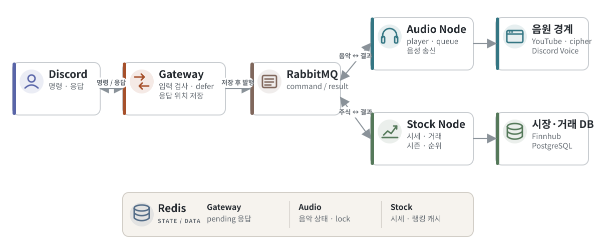

| 구성요소 | 책임 | 직접 소유하지 않는 것 |
| --- | --- | --- |
| Gateway | Discord 명령 등록·입력 검사, 공개 범위, pending 응답, 최종 회신 | 음악 player, 주식 계좌 계산 |
| Audio Node | 음악 명령 소비, 길드별 player·queue, 음성 연결, 재생 실패·복구 | Discord slash command UI, 주식 데이터 |
| Stock Node | 시세 캐시, 계좌·보유 종목·거래 내역, 시즌·랭킹·청산 | JDA 연결, 음악 상태 |
| RabbitMQ | command/result 라우팅 | 장기 업무 데이터 |
| Redis | 짧게 유지되는 응답 위치, 음악 상태·잠금·dedup, 시세·랭킹 캐시 | 매수·매도 내역의 최종 기록 |
| PostgreSQL | 계좌·보유 종목·매매 내역·지급 내역, snapshot, watchlist | Discord interaction token |

Gateway와 Audio Node는 같은 봇 계정으로 JDA에 연결하지만 목적이 다르다. Gateway는 채팅 interaction을 받고, Audio Node는 길드 음성 연결과 오디오 전송을 맡는다. Stock Node는 Discord에 직접 연결하지 않는다.

명령에는 `commandId`, `guildId`, 요청 사용자와 응답 대상 Gateway가 포함된다. 결과는 해당 Gateway의 결과 큐로 돌아간다.

---

**DIS · MODULE BOUNDARIES**

# 실행 앱과 공유 모듈

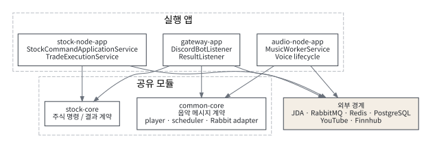

| 디렉터리 | 주요 코드 | 변경이 필요한 경우 |
| --- | --- | --- |
| `apps/gateway-app` | `DiscordBotListener`, 명령 catalog, 음악·주식 result listener, Redis pending repository | 명령 옵션, 응답 공개 범위, Discord 표시 형식 변경 |
| `apps/audio-node-app` | 음악 command listener 조립, 음성 상태 복구, 빈 채널 퇴장 | worker 기동·종료, 길드 음성 lifecycle 변경 |
| `apps/stock-node-app` | `StockCommandApplicationService`, 거래·랭킹·시세 scheduler, JPA entity | 주식 정책, 거래 저장, 시세 공급자 변경 |
| `modules/common-core` | 음악 message contract, `PlayerManager`, `TrackScheduler`, Rabbit adapter, DAVE/JDA 조립 | 음악 명령 계약, 재생·대기열·실패 처리 변경 |
| `modules/stock-core` | 주식 command/result envelope | Gateway와 Stock Node 사이 계약 변경 |

## 변경 순서

예를 들어 `/stock buy` 옵션을 바꿀 때는 Discord command catalog만 고치면 끝나지 않는다. Gateway가 envelope을 만드는 코드, `stock-core` 계약, Stock Node 분기와 검증, 결과 formatter, 양쪽 계약 테스트를 함께 본다. 음악도 같은 방식으로 명령 DTO와 worker 처리 사이의 schema version을 유지한다.

## 분리 과정에서 남긴 경계

- Gateway가 업무 계산을 하지 않도록 한다. 직접 응답하는 `/man`, `/pizza`만 예외다.
- Stock Node는 JDA 의존 없이 command/result 메시지로만 Discord와 연결된다.
- 음악 공용 코드는 Gateway의 autocomplete와 Audio Node의 재생 양쪽에서 필요해 `common-core`에 둔다.
- 앱별 설정은 Spring configuration에서 조립하고, 도메인 서비스가 환경 변수를 직접 읽지 않게 했다.

---

**DIS · ASYNC COMMAND CONTRACT**

# 작업을 보내기 전에 답변 위치를 저장한다

Discord interaction 응답은 Gateway 프로세스 안의 객체다. worker가 결과를 만들 때는 그 객체에 접근할 수 없다. Gateway가 `commandId → interaction token`을 Redis에 저장하고, 결과 listener가 나중에 찾아 원래 응답을 편집한다.

```java
event.deferReply(ephemeral).queue(hook -> {
    pendingInteractionRepository.put(
        commandId,
        new InteractionResponseContext(
            event.getToken(), event.getName(), guildId,
            channelId, now, now + TTL.toMillis()));

    dispatchFutureSupplier.get();
});
```

*코드 위치: `apps/gateway-app/.../DiscordBotListener.java`*

핵심은 발행 순서다. command를 먼저 발행하면 worker가 빠르게 처리한 결과가 pending 저장보다 먼저 돌아올 수 있다. result listener는 `commandId`를 찾지 못하고 응답을 버리게 된다. 현재 코드는 `defer → pending 저장 → command 발행` 순서다. pending 저장이 실패하면 업무 명령도 보내지 않고 현재 Discord hook에 오류를 쓴다.

## 메시지에 포함한 식별자

| 필드 | 용도 |
| --- | --- |
| `commandId` | 명령, 결과, pending 응답을 하나로 연결 |
| `schemaVersion` | Gateway와 worker의 계약 버전 확인 |
| `guildId`, `userId` | 길드 상태와 사용자 계좌 범위 지정 |
| `responseTargetNode` | 결과를 발행한 명령의 Gateway 큐로 반환 |
| `responseMode` 또는 `ephemeral` | 최종 Discord 공개 범위 유지 |

pending TTL은 15분이다. 음악 재생은 검색 결과 뒤에도 실패할 수 있어 성공 응답 직후 pending을 바로 지우지 않고 후속 실패를 받을 수 있게 둔다.

---

**DIS · STATE OWNERSHIP**

# 임시 상태와 거래 기록을 나눠 저장한다

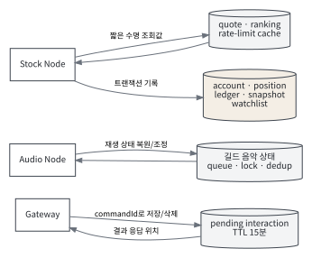

| 저장소 | 저장 내용 | 수명·복구 기준 |
| --- | --- | --- |
| Redis pending | interaction token, 명령·길드·채널, 만료 시각 | 15분. 결과가 원 응답을 찾는 용도 |
| Redis music | 길드별 현재 재생 정보, 대기열, lock, command dedup | Audio Node 재시작 때 복구 시도. 실제 player 메모리와 맞춰야 함 |
| Redis stock | quote, ranking, rate limit 상태 | quote 기본 TTL 60초. 거래는 45초 이내 시세만 허용 |
| PostgreSQL stock | 계좌, 보유 종목, 매매·지급 내역, 자산 snapshot, watchlist | 재시작 뒤에도 유지되는 기준 데이터 |

Redis에 모든 것을 넣지 않은 이유는 값의 성격이 다르기 때문이다. interaction token과 시세는 시간이 지나면 의미가 없지만 매수·매도 내역은 시즌이 끝난 뒤에도 조회와 정산 근거로 남아야 한다.

## 동시 처리에서 확인한 항목

- 길드별 음악 명령은 lock과 dedup 범위를 공유한다.
- 같은 주식 거래 안에서 현금 잔고, 보유 종목, 매수·매도 내역을 하나의 DB transaction으로 바꾼다.
- 거래가 끝나면 해당 길드·시즌 ranking cache를 비워 다음 조회가 새 자산을 반영하게 한다.
- watchlist에 없는 종목은 시세가 있더라도 거래하지 않는다.
- 음악과 주식 메시징 정책은 같지 않다. 음악에는 dedup·DLQ 재처리 경로가 있으나, 주식 명령에 같은 보장을 과장해 적용하지 않는다.

## 복구의 한계

Redis에 저장된 queue만으로 이미 재생 중이던 음성 스트림을 그대로 이어갈 수는 없다. 재시작 시 길드 상태를 다시 만들고 가능한 항목을 복구하는 방식이다. PostgreSQL의 계좌 기록과 달리 오디오 player는 실행 프로세스가 소유하는 자원이다.

---

**DIS · DISCORD VOICE**

# DAVE 음성 연결 적용

텍스트 명령은 정상인데 봇이 음성 채널 연결을 끝내지 못하는 문제가 있었다. 명령 처리나 권한만 보지 않고 JDA 음성 연결 단계와 Discord의 DAVE 종단 간 암호화 적용 여부를 확인했다.


```java
var daveFactory = new NativeDaveFactory();
var daveSessionFactory =
    new LDJDADaveSessionFactory(daveFactory);

var audioConfig = new AudioModuleConfig()
    .withDaveSessionFactory(daveSessionFactory);

JDABuilder.createDefault(token, GUILD_VOICE_STATES)
    .setAudioModuleConfig(audioConfig);
```

*코드 위치: `modules/common-core/.../ApplicationFactory.java`*

## 코드 외에 같이 맞춘 조건

| 확인 항목 | 이유 |
| --- | --- |
| Linux용 네이티브 파일 | 개발 PC와 운영 컨테이너의 운영체제가 달라 같은 파일을 쓸 수 없음 |
| `GUILD_VOICE_STATES` intent | 사용자의 음성 채널과 연결 상태를 읽기 위해 필요 |
| `VOICE_CONNECT`, `VOICE_SPEAK` 권한 | slash command 수신과 음성 연결 권한은 별개 |
| 실제 연결 상태 | `openAudioConnection` 호출 자체를 성공으로 판단하지 않기 위해 확인 |

이 변경 뒤에도 음원이 나오지 않을 수 있다. DAVE는 Discord 음성 연결 구간의 문제를 해결하고, YouTube 검색·다운로드·디코딩은 별도 경로다. 장애를 “음악이 안 된다” 한 문장으로 묶지 않고 연결, source load, stream read, Discord 전송 단계로 나누게 된 계기였다.

---

**DIS · PLAYBACK PIPELINE**

# 검색 성공 뒤에도 재생 단계는 남아 있다

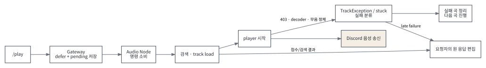

## 처리 단계

1. Gateway가 `/play`의 검색어, 길드, 사용자, 텍스트·음성 채널을 command로 만든다.
2. Audio Node의 `MusicWorkerService`가 길드와 채널을 확인하고 `PlayerManager.loadAndPlay`를 호출한다.
3. LavaPlayer가 `ytsearch:` 또는 URL을 읽어 playlist/track metadata를 얻는다.
4. 길드의 `TrackScheduler`가 현재 player가 비어 있으면 곡을 시작하고, 아니면 queue에 넣는다.
5. `YoutubeAudioTrack`이 실제 media URL을 구하고 cipher가 필요한 주소를 해석한다.
6. `AudioPlayerSendHandler`가 Opus frame을 JDA 음성 연결에 공급한다.

## 요청 접수와 재생 성공의 차이

검색 결과가 반환되면 곡 제목을 알 수 있으므로 사용자에게 접수 결과를 먼저 보낼 수 있다. 하지만 실제 media URL의 403, 로그인 요구, decoder 오류는 track thread에서 뒤늦게 발생한다. 따라서 `TrackStartEvent`만으로 실제 소리가 계속 나온다고 판단하지 않는다.

## 길드별 상태

`PlayerManager`는 길드별 `GuildMusicManager`를 만들고 그 안에서 player와 scheduler를 함께 관리한다. queue 조작과 pause/skip/stop도 같은 길드 manager를 찾는다. 빈 음성 채널이 되면 기본 5초 뒤 퇴장하도록 예약하고, 사용자가 돌아오면 예약을 취소한다.

자동 재생은 일반 queue load와 source가 다르다. pending load source를 구분해 사용자가 queue를 비웠거나 재생을 멈췄을 때 늦게 돌아온 autoplay 결과가 다시 곡을 넣지 않게 한다.

---

**DIS · PLAYBACK FAILURE**

# 접수 이후의 실패를 원 요청에 다시 전달한다

운영에서 `/play` 응답은 곡 제목을 보여 줬지만 실제 소리는 나지 않았다. 로그에는 YouTube 클라이언트별 로그인 요구, 지원 가능한 stream 부재, media URL 403이 이어졌고 마지막 상태는 `LOAD_FAILED`였다. 검색이 아니라 실제 음원 읽기 단계의 실패였다.

```java
private void reportPlaybackFailure(
        AudioTrack track, String type, Throwable failure) {
    PlaybackRequest request = playbackRequests.get(track);
    if (request == null ||
        !request.failureReported.compareAndSet(false, true)) return;

    playbackResultPublisher.accept(
        new MusicCommandResultEvent(
            trace.commandId(), trace.schemaVersion(),
            now, ownerNode, trace.responseTargetNode(), guildId,
            false, "재생에 실패했습니다: " + title + "\n" + reason,
            true, "PLAYBACK_FAILED"));
}
```

*코드 위치: `modules/common-core/.../TrackScheduler.java`*

## 적용한 규칙

- track마다 `AtomicBoolean`으로 실패 통지를 한 번만 보낸다.
- signed media URL이나 인증 값이 예외에 들어올 수 있어 원문 전체를 사용자·로그에 그대로 남기지 않는다.
- 로그인 필요, 403, 지원하지 않는 stream, decoder 오류, playback stuck을 사용자용 문구로 분류한다.
- 실패 결과에 원 명령의 `commandId`와 `responseTargetNode`를 실어 같은 Discord 응답을 수정한다.
- 실패 곡을 정리한 뒤 queue의 다음 곡으로 진행한다.

테스트에서는 local track의 metadata를 읽은 뒤 파일을 지워 decoder 실패를 만들고, 중복 통지 억제와 다음 곡 진행을 확인한다. 실제 YouTube의 모든 영상 가용성을 보장하는 테스트는 아니므로 배포 뒤 smoke test에서 실제 소리도 듣는다.

---

**DIS · STOCK DOMAIN**

# 음악 봇의 사용자 범위 위에 모의투자를 추가했다

사용자 요청을 받아 서버 안에서 함께 참여할 수 있는 기능으로 주식 게임을 추가했다. Discord 길드와 사용자 ID가 계좌의 자연스러운 범위가 되고, 공개 매매 메시지와 순위가 커뮤니티 기능이 된다.

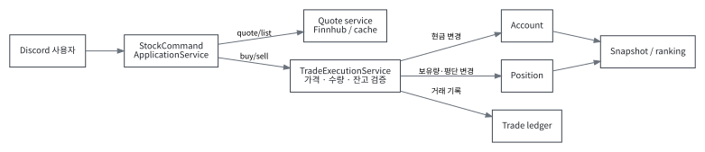

| 정책 | 현재 값·동작 |
| --- | --- |
| 계좌 범위 | `guildId + userId + seasonKey` |
| 시즌 | `Asia/Seoul` 기준 매월 1일 00:00 전환 |
| 시작 자금 | 시즌 첫 진입 시 10,000 지급 |
| 종목 | DB의 활성 watchlist. 초기 seed는 2026-05-01 기준 10종목 |
| 수량 | 정수 주식만 허용 |
| 레버리지 | 매수 시 1~50배, 같은 종목을 추가 매수할 때 기존 배율 유지 |
| 시세 | Redis TTL 60초, 거래는 45초 이내 quote만 허용 |
| 갱신 | Finnhub mode에서 실행 종료 후 기본 20초 대기 |
| 청산 | 갱신 성공 종목의 고립 증거금 평가 후 자산이 0 이하이면 처리 |

명령 처리 중 Finnhub를 직접 호출하지 않는다. scheduler가 watchlist의 가격을 갱신해 Redis에 넣고, 조회와 거래는 캐시를 읽는다. 외부 API 지연과 제한이 Discord command 처리 시간을 직접 늘리지 않게 한 선택이다.

기본 provider는 `mock`이지만 자동 갱신은 Finnhub mode에서만 돈다. 새 환경의 빈 Redis에서 `mock`을 선택하면 가격 조회와 거래는 준비되지 않았다고 응답할 수 있다. 종목 목록 자체는 가격 없이 표시할 수 있다.

---

**DIS · TRADE IMPLEMENTATION**

# 한 거래에서 잔고·보유 종목·거래 내역을 같이 반영한다

`TradeExecutionService.buy`와 `sell`은 `@Transactional` 경계 안에서 검증과 저장을 수행한다. 매수 순서는 다음과 같다.

```java
BigDecimal quantity = normalizeWholeShareQuantity(input, "매수 수량");
validateLeverage(leverage);
watchlist.validateTradable(market, symbol);

StockAccountEntity account = allowance.ensureSettledAccount(guildId, userId);
StockQuoteResult quote = quoteService.getQuote(market, symbol, TRADE);
ensureFreshQuote(quote, symbol);

BigDecimal notional = quantity.multiply(quote.price());
BigDecimal margin = notional.divide(BigDecimal.valueOf(leverage), ...);
if (account.getCashBalance().compareTo(margin) < 0) throw ...;

account.subtractCash(margin);
position.applyBuy(quantity, price, margin, notional, leverage);
ledgerRepository.save(TradeLedgerEntity.create(...));
rankingCache.evictGuild(guildId, account.getSeasonKey());
```

코드의 `TradeLedgerEntity`는 매수·매도 한 건의 종목, 수량, 가격, 증거금과 발생 시각을 저장한다. 본문에서는 이를 `거래 내역`으로 표기했다.

## 매도 계산

부분 매도는 `매도 수량 / 전체 수량` 비율로 기존 증거금과 명목 금액을 해제한다. 실현 손익은 `수량 × (현재가 - 평균 단가)`로 계산하고, 해제 증거금과 합쳐 현금 잔고에 반영한다. 보유 수량이 0이면 보유 종목 row를 삭제하고 매도 내역은 남긴다.

## 거래 전에 거절하는 조건

| 조건 | 응답 이유 |
| --- | --- |
| 0 이하 또는 소수 수량 | 정수 주식 수량 정책 위반 |
| 1 미만·50 초과 leverage | 지원 범위 밖 |
| 비활성 종목 | watchlist 정책 위반 |
| 45초보다 오래된 quote | 체결 가격으로 쓰기 어려움 |
| 부족한 현금·보유 수량 | 계좌 불변식 위반 |
| 기존 보유 종목과 다른 leverage | 같은 종목의 증거금 계산 기준이 섞임 |

거래 후 ranking cache를 비우는 작업도 같은 서비스에서 수행한다. 캐시 삭제 실패까지 DB 거래를 되돌릴지 여부는 저장소 경계와 장애 정책을 더 분리할 때 다시 검토할 항목이다.

---

**DIS · DELIVERY AND OPERATIONS**

# 배포, 관측, 검증을 서로 다른 단계로 둔다

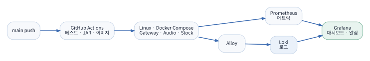

## 배포

`main` push 또는 수동 실행으로 GitHub Actions의 Deploy Bot이 시작된다. 전체 Gradle test와 세 앱 JAR 생성을 통과한 뒤 container image를 만들고 Linux 서버의 Compose release를 갱신한다. 테스트 보고서는 커밋 SHA가 붙은 artifact로 남긴다.

YouTube source 1.18.2는 Maven 공급 문제를 겪은 뒤 공식 GitHub release 파일과 SHA-256을 함께 관리한다. 빌드 전 `verifyYoutubeSources`가 파일을 검사한다. 의존성 다운로드 경로를 바꾸더라도 같은 upstream binary인지 확인하기 위한 장치다.

## 관측

| 도구 | 수집·확인 내용 |
| --- | --- |
| Spring Actuator | 앱별 health, info, Prometheus metrics |
| Prometheus | Gateway·Audio·Stock metrics scrape |
| Alloy → Loki | Docker stdout의 구조화 로그 수집 |
| Grafana | 앱 상태, JVM·업무 지표, 로그 조회 |

전체 분산 trace는 현재 구현 범위가 아니다. 대신 `commandId`, `guildId`, producer, event type을 구조화 로그에 남겨 명령과 결과를 따라간다.

## 검증 계층

1. 단위·통합 테스트: 명령 계약, pending 순서, 음악 failure, stock 거래·저장·메시징.
2. container health: 각 앱과 Redis·RabbitMQ·PostgreSQL 기동.
3. Discord smoke: `/man`, 음악 제어, stock 조회·거래 공개 범위.
4. 실제 청취: `/play` 뒤 소리가 지속되는지 확인.

현재 저장소에는 최대 동시 길드 수나 p95를 주장할 성능 결과가 없다. 내부 주입기는 worker·queue·DB 병목을 찾는 데 쓰며 Discord ACK·REST 제한과 음성 구간은 작은 실제 실험으로 따로 확인해야 한다.

---

**DIS · DECISIONS AND LIMITS**

# 현재 구조에서 내린 판단과 남은 제한

| 판단 | 선택 이유 | 대가·남은 일 |
| --- | --- | --- |
| Gateway와 worker 분리 | Discord UI 변경과 음악·주식 처리를 독립적으로 배포·관찰 | command/result 계약과 pending 저장이 필요 |
| Redis에 응답·음악 상태 | 프로세스 재시작과 여러 앱 사이에서 짧은 상태 공유 | TTL 만료, Redis 장애 때 늦은 결과를 회신할 수 없음 |
| 거래는 PostgreSQL | 잔고·보유 종목·거래 내역의 transaction 보장 | DB가 Stock Node의 핵심 의존점이 됨 |
| 시세 선갱신 후 캐시 조회 | Discord 명령 중 외부 API 지연·rate limit 분리 | 갱신 실패 시 거래를 중단해야 함 |
| 접수와 재생 실패 분리 | 검색 뒤 발생하는 media 오류를 사용자에게 알림 | pending을 더 오래 보관하고 후속 결과 우선순위 관리 |
| DAVE session을 JDA 조립부에 적용 | 음성 보안 구현을 player 업무 코드와 분리 | 운영체제별 네이티브 파일 관리 필요 |

## 수평 확장 제한

Gateway 결과는 `responseTargetNode`로 되돌릴 수 있어 node별 큐 구성이 가능하다. Audio Node는 같은 방식으로 단순 복제할 수 없다. 재생 중인 길드의 player와 Discord 음성 연결은 특정 프로세스가 소유한다. 여러 Audio Node를 두려면 `guildId → ownerNode` 라우팅, owner heartbeat, 장애 시 재할당, 중복 음성 연결 방지를 함께 설계해야 한다.

## 운영 중 계속 보는 항목

- YouTube OAuth가 켜졌다는 로그와 실제 token refresh 성공을 구분한다.
- cipher service가 살아 있어도 media CDN이 403을 줄 수 있다.
- health check 성공을 Discord 음성 성공으로 해석하지 않는다.
- stock quote 갱신이 멈추면 청산 검사도 같은 경로에서 멈춘다.
- DLQ 재처리는 부작용이 있는 명령이므로 자동 반복보다 원인 확인 뒤 수행한다.

DIS는 기능을 나눈 것으로 끝난 프로젝트가 아니다. 외부 서비스의 변화가 내부 상태와 사용자 응답에 어떻게 드러나는지 계속 확인하는 운영 프로젝트다.

---

**02**

# LawGround

## 법령 근거 기반 기출문제 분석

사용자가 5지선다 문제와 기준일을 저장하면, 해당 시점에 유효한 법령을 찾아 선지별 판단 근거를 만드는 서비스다. 나는 Spring 백엔드와 PostgreSQL 구조, 사용자·문제 API, 오래 걸리는 분석 작업의 상태 관리, 법령 검색과 외부 AI 계약을 맡았다.

이 프로젝트는 현재 상태를 두 범위로 나눠 봐야 한다.

| 구분 | 현재 상태 |
| --- | --- |
| 실제 화면·API에 연결 | Google 로그인, CSRF·JDBC session, 문제 등록·상세·목록·수정·삭제, 소유권, cursor pagination |
| 백엔드 기반 구현 | 분석 run/job 생성·조회·취소, lease·fencing·checkpoint·재시도, PostgreSQL FTS+pgvector 검색, RRF, 외부 AI HTTP client와 응답 검사, 추천·평가 기반 |
| 기본 OFF | LIVE worker, 새 분석 화면. 설정과 의존 서비스가 준비된 환경에서만 켬 |
| 아직 검증 필요 | 실제 Python 모델, 공식 법령 말뭉치 수집·검수, 최종 판정 정확도, 운영 품질·성능 |

화면에서 문제를 저장하고 관리하는 흐름은 실제 Spring API와 DB를 사용한다. 반면 개발 Mock 결과나 fixture 검색 성공을 실제 법령 분석 품질로 쓰지 않는다. verifier가 꺼진 LIVE 경로는 검색 뒤 `FAILED / VERIFIER_NOT_CONFIGURED`로 끝난다.

**저장소** github.com/lawground-team/LawGround　　**담당** Spring 백엔드·DB·분석 작업·검색 연결

---

**LAWGROUND · FUNCTIONAL SPECIFICATION**

# 기능과 사용자 워크플로우

## 사용자 기능

| 기능 | API | 처리 |
| --- | --- | --- |
| 로그인 상태 | `GET /api/v1/me`, `/auth/csrf` | Google OIDC 사용자와 CSRF token 확인 |
| 문제 등록 | `POST /api/v1/questions` | 과목, 지문, 선지 5개, 사용자 답, 기준일 저장 |
| 상세·목록 | `GET /questions/{id}`, `GET /questions?scope=mine` | 소유 문제 또는 승인된 공개 문제 조회 |
| 수정·삭제 | `PUT`, `DELETE /questions/{id}` | `If-Match` revision 검사 후 변경·soft delete |
| 분석 접수 | `POST /questions/{id}/trace-runs` | snapshot·version을 고정하고 run/job 생성 |
| 상태 조회 | `GET /jobs/{id}`, `/trace-runs/{id}` | 비동기 단계·오류·완료 상태 조회 |
| 결과 조회·취소 | `GET /trace-runs/{id}/result`, `POST .../cancel` | 소유권을 확인해 결과 제공 또는 실행 취소 |
| 추천 | `GET /trace-runs/{id}/recommendations` | 같은 근거·시행기간과 embedding 후보를 조회 |

## 화면 기준 흐름

1. 사용자가 Google로 로그인하고 문제 지문, 선지 5개, 본인이 고른 답, 법령 기준일을 입력한다.
2. Spring이 사용자를 확인하고 정규화한 내용 hash로 같은 사용자의 중복 문제를 막는다.
3. 저장 응답의 `ETag`에 revision을 내려준다. 목록과 상세 화면에서 문제를 다시 조회한다.
4. 수정·삭제 요청은 마지막으로 본 revision을 `If-Match`로 보낸다. 다른 변경이 먼저 있으면 409로 다시 조회하게 한다.
5. 분석이 켜진 환경에서는 요청 시점의 문제와 기준일, 검색·모델·코드 version을 snapshot으로 고정한다.
6. API는 긴 작업이 끝날 때까지 연결을 잡지 않고 run/job 식별자를 반환한다. 화면은 상태를 조회한다.
7. 완료 결과는 선지별 판정과 법령 인용을 제공해야 한다. 현재 기본 화면은 실제 모델 품질이 준비되지 않아 새 분석을 켜지 않는다.

---

**LAWGROUND · SYSTEM ARCHITECTURE**

# 업무 데이터는 Spring과 PostgreSQL이 소유한다

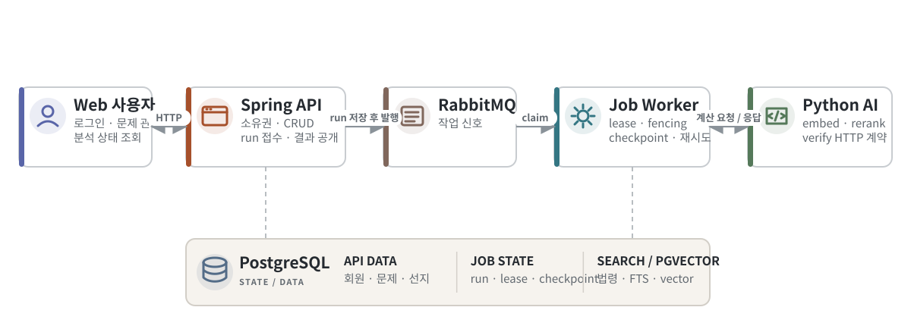

| 경계 | 책임 |
| --- | --- |
| Spring API | 로그인·권한, 문제 CRUD, run 접수·조회·취소, 최종 결과 공개 |
| PostgreSQL | 사용자·문제·선지, run/job, checkpoint, 법령 원문·색인, 평가·추천 데이터 |
| RabbitMQ | 처리할 job이 생겼다는 신호. 최종 업무 상태의 기준 저장소는 아님 |
| Spring worker | job claim, 단계 실행, lease 갱신, AI client 호출, 검증 후 DB 저장 |
| Python AI HTTP | embedding, tokenize, HyDE, rerank, verify 계산 계약. DB를 직접 수정하지 않음 |

Python이 RabbitMQ를 직접 소비하거나 PostgreSQL에 결과를 저장하게 하지 않았다. Spring이 사용자 소유권과 job 상태를 이미 관리하므로, 외부 계산 서비스는 입력을 받아 계산 결과만 돌려주는 경계로 잡았다. 재시도와 최종 상태 결정도 Spring job 단계에서 한 번 관리한다.

## 요청과 작업을 함께 저장하는 이유

DB commit 후 queue 발행이 실패하거나 같은 메시지가 다시 올 수 있다. queue 메시지만 업무 상태로 삼으면 작업을 잃거나 중복 처리 여부를 판단하기 어렵다. `trace_runs`와 `processing_jobs`를 먼저 저장해 실행 의도를 남기고, worker는 DB row를 claim할 때 실제 실행 권한을 얻는다.

현재 필수 범위에 outbox 전체 구현을 넣지는 않았다. 발행 실패·재발행 경로와 중복 전달은 job row와 claim 조건으로 다루되, 정확히 한 번 전달을 보장한다고 쓰지 않는다.

---

**LAWGROUND · DATA MODEL**

# 문제 revision과 분석 snapshot을 분리한다

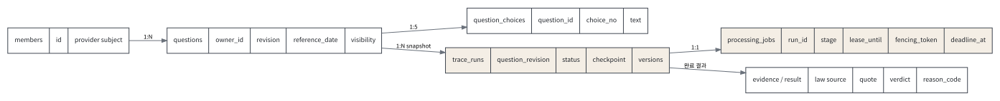

## 문제 데이터

`questions`는 owner, 지문, 과목, 기준일, 제공 답, 공개 범위, source 종류, `revision`, content hash를 가진다. 선지 5개는 `question_choices`에 저장한다. 같은 사용자가 같은 내용을 중복 등록하지 않도록 canonical JSON을 SHA-256으로 만든 뒤 애플리케이션 선검사와 DB unique constraint를 함께 사용한다.

수정은 원 row를 덮어쓰되 revision을 1 올린다. 분석 이력은 수정된 현재 문제를 따라 바뀌면 안 되므로 `trace_runs`에 `question_revision`, `input_snapshot`, `input_hash`, `reference_date`를 복사한다.

## 실행 데이터

| 필드 | 이유 |
| --- | --- |
| `execution_mode` | MOCK과 LIVE 결과 혼동 방지 |
| `pipeline_version` | 결과를 만든 처리 흐름 식별 |
| `config_snapshot` | topK, 기능 flag 등 실행 당시 설정 보존 |
| `versions` | embedding, tokenizer, chunker, verifier, source commit 고정 |
| `corpus_manifest` | 어떤 법령 corpus를 검색했는지 기록 |
| `checkpoint` | 완료한 단계와 중간 결과를 재시작 뒤 이어가기 |
| `deadline_at` | 오래 멈춘 작업의 최종 종료 기준 |
| `lease_until`, `fencing_token` | 동시 worker와 늦은 결과 저장 차단 |

## 기준일 처리

검색 대상 법령 version은 `effective_from <= referenceDate`이고 `effective_to`가 없거나 기준일보다 뒤인 행만 고른다. 최신 법령만 검색하면 과거 기출의 판단 근거가 달라질 수 있기 때문에 문제 입력 시 기준일을 필수로 받는다.

---

**LAWGROUND · AUTH AND QUESTION LIBRARY**

# 사용자 소유권과 수정 충돌을 API에서 확인한다

운영 profile은 Google OIDC provider만 허용하고 로그인 결과를 JDBC session과 연결한다. 문제 조회는 owner이거나 승인된 공개 문제일 때만 가능하다. 수정·삭제는 owner만 수행한다.

```java
private void lockOwned(UUID id, UUID owner, long expected) {
    var revisions = jdbc.query(
        "SELECT revision FROM questions " +
        "WHERE id=? AND owner_id=? AND deleted_at IS NULL FOR UPDATE",
        mapper, id, owner);

    if (revisions.isEmpty()) throw notFound();
    if (revisions.getFirst() != expected)
        throw new ApiException(CONFLICT, VERSION_CONFLICT,
            "문제가 변경되었습니다. 다시 조회해 주세요.");
}
```

*코드 위치: `backend/.../QuestionLibraryService.java`*

## API에서 정한 규칙

| 항목 | 구현 |
| --- | --- |
| 5지선다 | 선지 번호 1~5가 각각 한 번 있는지 검사 |
| 중복 문제 | 정렬된 선지와 필드로 canonical hash 생성, owner+hash unique |
| 동시 수정 | 응답 `ETag` revision과 요청 `If-Match` 비교 |
| 목록 | `(created_at, id)` cursor로 다음 페이지 조회 |
| 삭제 | `deleted_at`을 기록하고 대기·실행 중 분석 run/job 취소 |
| 공개 조회 | `visibility=PUBLIC`만 다른 사용자가 읽을 수 있음 |

목록은 최신 분석 run 요약을 lateral join으로 함께 가져온다. 화면은 문제와 분석 상태를 따로 여러 번 조회하지 않고, 목록에서 마지막 실행 상태를 표시할 수 있다.

삭제 시 문제 row만 숨기고 작업을 그대로 두면 worker가 이미 삭제된 입력의 결과를 나중에 저장할 수 있다. 문제 soft delete와 함께 `QUEUED/RUNNING` run을 취소하고 processing job도 terminal 상태로 바꾼다.

---

**LAWGROUND · ASYNC ANALYSIS**

# 오래 걸리는 분석을 요청 연결과 분리한다

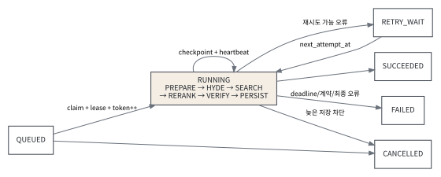

## 실행 단계

| 단계 | 하는 일 | checkpoint에 남기는 것 |
| --- | --- | --- |
| PREPARE | snapshot·권한·version·deadline 확인 | 실행 조건 확인 |
| HYDE | 설정이 켜진 경우 검색 보조 문장 생성 | 원문과 구분된 보조 입력 |
| SEARCH | 기준일 법령에 lexical·dense 검색 | 후보 chunk와 검색 pin |
| RERANK | 외부 점수 계약을 검사해 후보 순서 변경 | 사용한 후보와 점수 |
| VERIFY | 선지별 판정과 evidence 응답 검사 | verdict, 인용, reason |
| PERSIST | 최종 결과·상태 저장 | 완료 표시 |

## worker가 작업을 가져가는 조건

`claim`은 job row뿐 아니라 run, question, member 상태를 함께 읽고 잠근다. 삭제·취소, deadline 초과, 다른 실행 mode, 유효한 기존 lease, retry 대기 시간, 접근 권한, 평가·배치 코드 version 불일치가 있으면 작업하지 않는다.

작업 중에는 heartbeat가 lease를 연장한다. 재시도 가능한 외부 오류는 `RETRY_WAIT`와 `next_attempt_at`을 남기고, 계약 위반·권한 상실·deadline 초과는 실패로 끝낸다. 취소 요청은 worker의 계산 중단과 결과 저장 차단을 구분한다. 외부 HTTP가 즉시 중단되지 않더라도 마지막 DB update에 현재 token과 상태 조건을 넣어 취소 뒤 결과가 들어오지 않게 한다.

checkpoint는 단순 진행률 표시가 아니다. SEARCH가 끝난 뒤 프로세스가 재시작되면 저장된 검색 결과와 version을 다시 검사하고 VERIFY부터 이어갈 수 있게 한다.

---

**LAWGROUND · LEASE AND FENCING**

# 오래된 worker의 결과를 fencing token으로 막는다

```java
@Transactional
public Claim claim(UUID id, String worker, String mode) {
    var row = lock(id);
    if (row == null || !mode.equals(row.get("execution_mode"))) return null;
    if (cancelled(row) || deadlineExceeded(row)) return terminal(row);
    if ("RUNNING".equals(row.get("status")) &&
        time(row, "lease_until").isAfter(now)) return null;

    long token = ((Number) row.get("fencing_token")).longValue() + 1;
    jdbc.update("UPDATE processing_jobs SET status='RUNNING', " +
        "fencing_token=?, lease_owner=?, lease_until=? WHERE id=?",
        token, worker, now.plus(lease), id);
    return claimOf(row, token);
}
```

완료·heartbeat·재시도 update는 모두 `WHERE id=? AND fencing_token=?` 조건을 사용한다. worker A의 lease가 끝난 뒤 worker B가 token 8로 다시 claim했다면, 늦게 돌아온 A의 token 7 결과는 update row 수가 0이 되어 저장되지 않는다.

## checkpoint와 단계 시도 횟수

```sql
UPDATE processing_jobs
SET stage=?,
    stage_attempts=jsonb_set(stage_attempts, ARRAY[?], to_jsonb(?)),
    updated_at=?
WHERE id=? AND fencing_token=?;

UPDATE trace_runs
SET checkpoint=jsonb_set(checkpoint, ARRAY[?], 'true'::jsonb)
WHERE id=?;
```

단계 시작 전에 attempt를 남기고, 결과와 단계 완료 flag를 구분한다. 프로세스가 중간에 끝나도 어떤 단계가 끝났는지와 몇 번 실행했는지 확인할 수 있다.

## 동시성 검증

통합 테스트에서 유효한 lease 동안 두 번째 claim이 거절되는지, lease 만료 뒤 token이 증가하는지, 이전 token의 complete가 실패하는지, 삭제·취소·deadline·version mismatch에서 실행되지 않는지 확인한다.

---

**LAWGROUND · RETRIEVAL AND VERIFICATION**

# 검색 결과와 법적 근거를 같은 것으로 취급하지 않는다

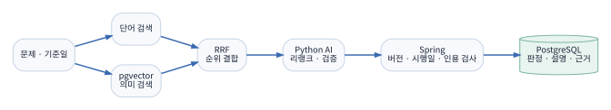

## 검색 파이프라인

1. 기준일과 법령 version의 적용 기간을 확인한다.
2. PostgreSQL FTS가 token 기반 후보를, pgvector cosine 검색이 의미 기반 후보를 만든다.
3. RRF가 두 목록의 순위만 사용해 결합한다. 기본 점수는 `1 / (60 + rank)`의 합이다.
4. rerank가 켜져 있으면 candidate ID와 점수 개수·범위를 검사한 뒤 새 순서를 사용한다.
5. verify 요청에는 선택한 법령 chunk와 선지, 고정된 version 정보를 넣는다.
6. Spring은 반환된 evidence가 실제 입력 chunk에 있고 quote와 위치가 원문과 맞는지 검사한 뒤 저장한다.

HyDE 문장은 검색 보조 입력일 뿐 법령 근거가 아니다. 원문 검색 OFF baseline을 유지하고, 평가 전에는 기본 ON으로 간주하지 않는다.

## 검증 경계

| 값 | Spring이 확인하는 것 |
| --- | --- |
| candidate | 요청에 보낸 chunk인지, 중복·누락이 없는지 |
| quote | 원문 substring과 code point 위치가 맞는지 |
| 법령 시점 | 기준일에 적용 가능한 verified version인지 |
| verdict | 허용 enum과 선지 수가 맞는지 |
| model 응답 | required/nullable, 길이·개수 상한, 계약 version |

검색 hit가 있다는 사실은 정답 판정이 아니다. verifier가 꺼져 있으면 검색 결과를 답으로 포장하지 않고 `VERIFIER_NOT_CONFIGURED`로 실패시킨다. 실제 정확도는 공식 corpus와 검수된 golden set으로 별도 측정해야 한다.

---

**LAWGROUND · VALIDATION AND OPEN WORK**

# 구현된 기반과 제품 완성도를 구분한다

## 확인한 범위

| 시험 | 확인 내용 | 확인하지 않는 것 |
| --- | --- | --- |
| 문제 API 통합 시험 | 소유권, validation, 중복 hash, revision, 목록 cursor, 삭제 | 실제 Google 계정별 브라우저 전체 흐름 |
| workflow 통합 시험 | 멱등 접수, claim, lease, fencing, retry, cancel, deadline, checkpoint | 실제 모델의 처리 시간과 품질 |
| 검색 시험 | fixture 법령의 FTS·vector·RRF, rerank 계약, 기준일 filtering | 전국 법령 corpus의 누락 여부 |
| verification 시험 | quote·offset·evidence 변조 거절, 응답 schema | 판정이 법적으로 옳은지 |
| 추천·평가 시험 | revision/model version/권한, 집계 기반 | 실제 사용자에게 유용한 추천 순위 |

## 제품으로 쓰기 전에 남은 일

1. 공식 법령 출처에서 version과 시행 기간을 수집하고 표본 검수를 통과해야 한다.
2. Python 서비스의 실제 model, timeout, idempotency, 오류 계약을 같은 fixture로 합의해야 한다.
3. verifier 결과를 사람이 검토한 golden set과 비교해 선지별 정확도와 인용 적합성을 측정해야 한다.
4. LIVE worker와 분석 화면을 켠 환경에서 로그인부터 결과 표시까지 E2E로 확인해야 한다.
5. queue 적체, DB search latency, model timeout을 함께 본 부하 시험이 필요하다.

법령 검색 SQL과 job 복구 코드가 동작해도 공식 데이터와 실제 모델 검증 전에는 법령 판단의 정확도를 주장할 수 없다. 현재 결과는 사용자 문제 관리와 분석 백엔드 기반이 구현된 단계다.

---

**03**

# Verbly

## 영어 표현 라이브러리와 복습 퀴즈

Verbly는 영어 일기를 AI와 원어민에게 첨삭받고, 고친 표현을 다시 학습하는 팀 프로젝트다. 전체 서비스에는 일기, 첨삭, 커뮤니티, 결제 등 여러 영역이 있다. 내가 맡은 범위는 교정 결과를 개인 학습 항목으로 저장하는 라이브러리와, 저장된 표현을 문제로 풀고 오답만 다시 도전하는 복습 기능이다.

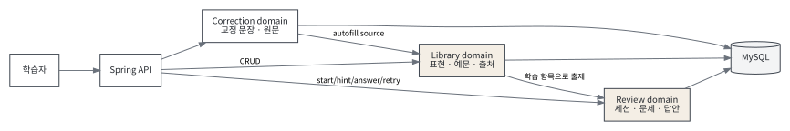

## 내가 구현한 사용자 흐름

1. 사용자가 첨삭된 일기를 확인한다.
2. 교정 결과에서 학습할 표현을 선택해 개인 라이브러리에 자동으로 넣는다.
3. 같은 표현이 이미 있으면 새 항목을 만들지 않고 교정 출처와 새 예문을 연결한다.
4. 사용자는 표현과 뜻, 예문을 직접 추가·수정·삭제할 수 있다.
5. 복습을 시작하면 대기 중인 라이브러리 항목으로 session과 문제를 만든다.
6. 문제를 순서대로 풀고 필요하면 session 단위 힌트를 사용한다.
7. 마지막 답을 제출하면 결과를 집계한다. 오답이 있으면 해당 항목만 새 문제로 다시 푼다.

## 설계에서 확인한 조건

- 다른 사용자의 correction, library item, quiz session을 ID만 바꿔 접근할 수 없어야 한다.
- 같은 사용자의 같은 표현은 공백·대소문자 차이로 중복 저장되지 않아야 한다.
- 자동 저장을 두 번 눌러도 source와 example이 불필요하게 늘지 않아야 한다.
- 답은 현재 문제 순서에만 제출할 수 있어야 한다.
- 오답 재도전에서 기존 answer를 지우기 전에 question을 지우면 FK 오류가 난다.

**저장소** github.com/Verbly-Team/Verbly-BE　　**담당** Library·Quiz Review 백엔드

---

**VERBLY · LIBRARY SPECIFICATION**

# 표현, 예문, 출처를 따로 저장한다

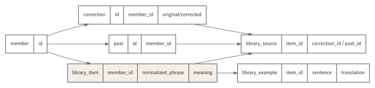

## API

| API | 동작 |
| --- | --- |
| `POST /api/library/items` | 표현과 뜻을 직접 등록 |
| `GET /api/library/items` | 내 학습 항목 목록 조회 |
| `GET /api/library/items/{itemId}` | 표현, 예문, 출처 상세 조회 |
| `PATCH /api/library/items/{itemId}` | 뜻과 상태 수정 |
| `DELETE /api/library/items/{itemId}` | 내 항목 삭제 처리 |
| `POST /api/library/items/{itemId}/examples` | 사용자가 예문 추가 |
| `DELETE .../examples/{exampleId}` | 내 항목의 예문 삭제 |
| `POST /api/library/autofill/corrections/{correctionId}` | 교정 결과의 표현·예문·출처를 자동 저장 |

## 모델을 나눈 이유

`LibraryItem` 하나에 교정 ID와 예문을 모두 문자열로 넣으면 같은 표현을 여러 교정에서 발견할 때 항목이 중복된다. 표현 자체, 예문, 발견 출처를 나눠 한 표현에 여러 예문과 여러 correction/post source를 연결했다.

| 모델 | 보관 내용 |
| --- | --- |
| `LibraryItem` | 사용자, 원문 표현, 정규화 표현, 한글·영문 뜻, 학습 상태 |
| `LibraryItemExample` | 영문 예문, 번역, AI/사용자 출처 |
| `LibraryItemSource` | 어떤 correction 또는 post에서 발견했는지 |
| `ReviewTask` | 라이브러리 항목의 복습 대기·진행·완료 상태 |

모든 조회·변경은 인증 사용자의 ID와 함께 검사한다. correction 자동 채우기도 먼저 correction의 소유자를 확인한 뒤 해당 correction이 연결된 post ID만 source에 기록한다.

---

**VERBLY · AUTOFILL IMPLEMENTATION**

# 정규화 키로 upsert하고 출처와 예문은 따로 중복 검사한다

자동 채우기는 AI 응답의 빈 항목을 제거하고 표현 양끝 기호와 공백을 정리한다. `normalizePhrase`로 만든 값이 사용자별 표현 key다.

```java
private LibraryItem upsertItem(
        Long userId, String phrase, String norm, String meaningKo) {
    return repository.findByUserIdAndPhraseNorm(userId, norm)
        .map(item -> {
            if (item.getStatus() == DELETED) item.reactivate();
            if (item.getMeaningKo() == null) item.updateMeanings(meaningKo, null);
            return item;
        })
        .orElseGet(() -> {
            try {
                return repository.save(
                    LibraryItem.of(userId, phrase, norm, meaningKo, null));
            } catch (DataIntegrityViolationException e) {
                return repository.findByUserIdAndPhraseNorm(userId, norm)
                    .orElseThrow(() -> e);
            }
        });
}
```

*코드 위치: `domain/library/service/LibraryAutoFillService.java`*

애플리케이션 조회 뒤 저장 사이에 같은 요청이 들어올 수 있어 DB unique 충돌이 생기면 같은 key를 다시 읽는다. 선조회만으로 동시 중복을 해결했다고 가정하지 않았다.

## 예문 저장 규칙

- 예문 안에 해당 표현이 단어 경계 기준으로 들어 있는지 확인한다.
- `take off`처럼 단어 사이 공백이 달라도 찾을 수 있게 정규식을 만든다.
- 같은 item의 같은 영문 예문은 다시 넣지 않는다.
- 유효한 예문이 하나도 없으면 `I want to {phrase}.` 형식의 fallback 한 개를 넣는다.
- 같은 correction source가 이미 있으면 source row를 다시 만들지 않는다.

항목, source, example의 생성 수를 결과로 돌려 자동 채우기가 실제로 무엇을 변경했는지 호출자가 확인할 수 있게 했다.

---

**VERBLY · QUIZ STATE AND ANSWERS**

# session 안에서 문제 순서와 답안 이력을 고정한다

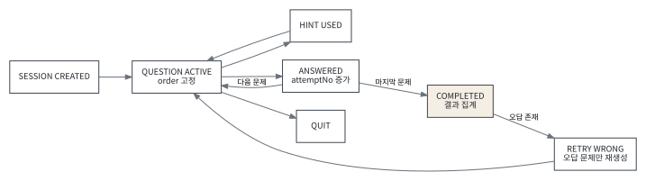

## API와 상태

| API | 상태 변화 |
| --- | --- |
| `POST /api/quizzes/sessions` | 기존 진행 session을 정리하고 PENDING task를 claim, 문제 생성 |
| `POST .../questions/{id}/hint` | session의 남은 힌트 수 차감 |
| `POST .../questions/{id}/answer` | 순서 검사, attempt 저장, 다음 문제 또는 완료 반환 |
| `POST .../quit` | session 종료, task를 PENDING으로 되돌리고 임시 문제 정리 |
| `GET .../result` | 소유 session의 정답·오답 결과 집계 |
| `POST .../mistakes/retry` | 마지막 답이 틀린 task만 새 session으로 재출제 |

```java
Integer order = question.getReviewTask().getTaskOrder();
if (order == null || order != session.getCurrentIndex())
    throw new ReviewHandler(QUIZ_OUT_OF_ORDER);

int nextAttempt = answerRepository
    .findTopByReviewQuestion_IdOrderByAttemptNoDesc(question.getId())
    .map(answer -> answer.getAttemptNo() + 1)
    .orElse(1);

boolean correct = grade(question, request.userAnswerJson());
answerRepository.save(ReviewAnswer.of(question, nextAttempt,
    request.userAnswerJson(), correct));
```

session, question, task가 모두 같은 사용자와 session에 속하는지 validator가 확인한다. client가 다음 문제 ID를 임의로 보내도 현재 `taskOrder`가 아니면 거절한다. 마지막 문제를 제출할 때 session과 모든 task를 한 transaction에서 `COMPLETED`로 바꾼다.

---

**VERBLY · RETRY AND REVIEW**

# 오답만 다시 만들되 기존 관계를 안전하게 정리한다

오답 재도전은 기존 session의 각 question에서 가장 높은 `attemptNo` 답을 고른다. 마지막 답이 없거나 틀린 question의 task만 `PENDING`으로 되돌린 뒤 새 문제를 만든다.

```java
Map<Long, ReviewAnswer> lastByQuestion = new LinkedHashMap<>();
for (ReviewAnswer answer : answers)
    lastByQuestion.putIfAbsent(answer.getReviewQuestion().getId(), answer);

Set<Long> wrongTaskIds = questions.stream()
    .filter(q -> {
        var last = lastByQuestion.get(q.getId());
        return last == null || !last.isCorrect();
    })
    .map(q -> q.getReviewTask().getId())
    .collect(toCollection(LinkedHashSet::new));

answerRepository.deleteAllByReviewQuestion_IdIn(wrongQuestionIds);
answerRepository.flush();
questionRepository.deleteAllByReviewTask_IdIn(wrongTaskIds);
questionRepository.flush();
```

answer가 question을 참조하므로 삭제 순서는 answer → flush → question → flush다. 같은 transaction 안에서도 JPA가 SQL을 원하는 순서로 미룰 수 있어 flush로 FK 선후 관계를 명시했다.

## 이 범위에서 확인한 사항

| 항목 | 확인 내용 |
| --- | --- |
| 소유권 | 다른 사용자의 correction, item, session, question 접근 거절 |
| 중복 | 사용자+정규화 표현, item+교정 source, item+예문 중복 방지 |
| 상태 | 진행 session 재진입, 순서 위반, 힌트 소진, 종료·완료 처리 |
| 재도전 | 마지막 답 기준 오답 선별, 정답 task 제외, FK 삭제 순서 |

내가 맡은 범위는 첨삭 결과를 개인 표현 데이터와 반복 학습 상태로 이어지게 만든 라이브러리와 복습 기능이다.

---

**윤영주**　github.com/som141　·　010-8977-9897
