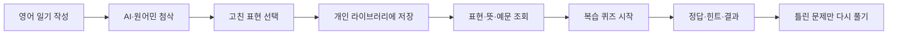

# 버블리(Verbly) · 영어 일기 첨삭·복습 서비스

버블리는 사용자가 쓴 영어 일기를 AI와 원어민에게 첨삭받고, 고친 표현을 개인 라이브러리와 퀴즈로 복습하는 서비스입니다. 저는 개인 라이브러리와 복습 퀴즈 백엔드를 담당했습니다.

| 항목 | 내용 |
| --- | --- |
| 기간 | 2026.01–2026.02 |
| 형태 | 팀 프로젝트 |
| 담당 | 개인 라이브러리, 복습 퀴즈 백엔드 |
| 주요 기술 | Java, Spring Boot, Spring Data JPA, MySQL |
| 저장소 | [github.com/Verbly-Official/BE](https://github.com/Verbly-Official/BE) |

## 맡은 사용자 흐름

첨삭을 한 번 읽고 끝내지 않고, 틀렸던 표현을 다시 사용할 수 있게 만드는 부분을 맡았습니다.

## 개인 라이브러리

사용자는 첨삭에서 배운 표현을 뜻과 예문과 함께 저장합니다. 같은 철자라도 대소문자나 불필요한 공백 때문에 중복 저장되지 않도록 표현을 정규화한 값을 따로 관리했습니다.

라이브러리 항목에는 다음 정보를 연결했습니다.

- 영어 표현과 한국어·영어 뜻
- 직접 입력하거나 첨삭에서 가져온 예문
- 표현이 나온 일기와 첨삭의 위치
- 북마크 여부와 삭제 상태

조회에서는 검색어, 북마크 여부, 페이지 조건을 적용합니다. 수정과 삭제, 예문 추가·삭제를 할 때는 요청한 사용자 소유의 항목인지 먼저 확인합니다. 삭제한 표현은 바로 행을 지우지 않고 상태를 바꿔 첨삭 출처와 기존 연결을 유지했습니다.

처음에는 등록·조회·수정·삭제가 한 서비스에 모여 있었지만 기능이 늘면서 조회와 변경 서비스를 나누고, DTO 변환과 소유권 검사를 별도 클래스로 옮겼습니다. 같은 조건이 여러 API에서 다르게 처리되는 일을 줄이기 위한 변경이었습니다.

- [개인 라이브러리를 처음 구현한 변경](https://github.com/Verbly-Official/BE/commit/51c6beae567e38b14c7ed4a3d0774d3987f207e9)
- [조회·변경·검사를 분리한 변경](https://github.com/Verbly-Official/BE/commit/abbf59d530ce3b051bfd09e91b628485e33c06fb)

## 첨삭 결과를 라이브러리로 연결하기

사용자가 첨삭 결과를 보고 표현을 저장할 때 같은 내용을 다시 입력하게 하고 싶지 않았습니다. 첨삭 데이터에서 원래 표현, 고친 표현, 뜻과 예문을 받아 라이브러리 항목과 출처를 함께 만드는 기능을 추가했습니다.

하나의 첨삭에서 여러 표현과 여러 예문이 올 수 있어 목록으로 입력받습니다. 각 표현을 정리한 뒤 이미 저장된 항목이면 새 항목을 만들지 않고 기존 항목에 출처와 예문을 연결합니다. 출처에는 게시글, 첨삭, 피드백, 문장 위치를 기록해 나중에 어떤 글에서 배운 표현인지 찾을 수 있게 했습니다.

팀의 첨삭 도메인과 연결되는 기능이어서 저장 형식이 바뀔 때마다 DTO와 반환값을 맞췄습니다. 개발 중에는 별도 테스트용 Controller로 연결을 먼저 확인한 뒤 실제 Controller로 옮겼습니다.

- [첨삭 데이터를 라이브러리에 연결한 변경](https://github.com/Verbly-Official/BE/commit/599172995b8d9b4a79dbc22ccf03e323212644c8)
- [여러 예문과 출처 저장을 보완한 변경](https://github.com/Verbly-Official/BE/commit/b0a8fa8d379a0ae400b18b35e8501fce7cc603a3)

## 복습 퀴즈

라이브러리에 저장된 표현을 퀴즈로 다시 풀 수 있도록 세션, 할 일, 문제, 답안을 나누어 저장했습니다.

| 데이터 | 맡은 역할 |
| --- | --- |
| ReviewTask | 아직 풀지 않은 라이브러리 항목과 진행 상태 |
| ReviewSession | 한 번의 퀴즈 진행 순서와 힌트 사용량 |
| ReviewQuestion | 빈칸·객관식 문제와 정답, 설명 |
| ReviewAnswer | 사용자가 제출한 답과 정답 여부, 시도 횟수 |

퀴즈를 시작하면 복습 대상인 라이브러리 항목을 세션에 묶고 문제를 만듭니다. 예문에서 학습 표현을 찾아 빈칸으로 바꾸거나, 다른 라이브러리 표현을 오답 선택지로 사용합니다. 사용자는 정해진 순서대로 답을 제출하고 힌트를 쓸 수 있습니다.

중간에 퀴즈를 나가면 해당 세션이 잡고 있던 항목을 다시 대기 상태로 돌립니다. 끝까지 푼 뒤에는 마지막 답안을 기준으로 틀린 항목만 골라 새로운 세션을 만들 수 있습니다. 기존 문제와 답안을 지울 때는 참조 관계 때문에 답안, 문제 순서로 삭제하도록 수정했습니다.

이 흐름을 한 API에 모으지 않고 시작, 답안 제출, 힌트, 종료, 결과 조회, 오답 재도전으로 나눴습니다. 각 요청에서 세션과 문제가 현재 사용자의 것인지, 아직 진행 중인지, 현재 순서와 맞는지 검사합니다.

- [복습 퀴즈의 저장 구조와 API를 만든 변경](https://github.com/Verbly-Official/BE/commit/aff779879fd0ad38cc6a2fd784da8de8a5782f89)
- [참조 관계를 고려해 퀴즈 종료를 수정한 변경](https://github.com/Verbly-Official/BE/commit/076ecb77b7011e2c7813a716271e11adeb54ddf5)
- [오답 재도전과 출제 방식을 정리한 변경](https://github.com/Verbly-Official/BE/commit/0894bc3de2e65ec503eab69cf480c46a27f21f6a)

## 팀에서 맡은 범위

전체 서비스 중 라이브러리와 복습 기능을 담당했습니다. 일기 작성, 사용자 인증, 결제, 원어민 첨삭 전체를 제가 구현한 것은 아닙니다. 다른 팀원이 만든 일기·첨삭 데이터와 연결할 때 필요한 ID와 데이터 형식을 맞추고, 라이브러리와 퀴즈 안에서는 사용자별 소유권과 진행 상태를 관리했습니다.

## 돌아보며 바꾸고 싶은 점

프로젝트 기간 안에 기능을 연결하는 데 집중하면서 퀴즈 출제 서비스에 문제 생성, 채점, 재도전 처리가 많이 모였습니다. 다시 개발한다면 문제 유형별 생성 규칙을 별도 클래스로 나누고, 퀴즈 시간과 무작위 선택을 테스트에서 고정할 수 있게 만들겠습니다.

라이브러리와 퀴즈 API에 대한 자동 테스트도 더 촘촘히 남길 필요가 있습니다. 특히 같은 표현을 동시에 저장하는 경우에는 애플리케이션 검사뿐 아니라 DB의 고유 제약 조건으로도 중복을 막는 편이 안전합니다.

[프로젝트 목록으로 돌아가기](README.md) · [이력서로 돌아가기](../README.md)
